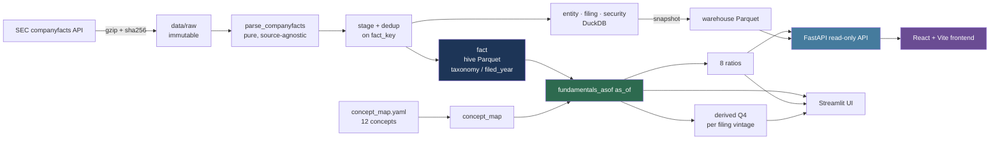
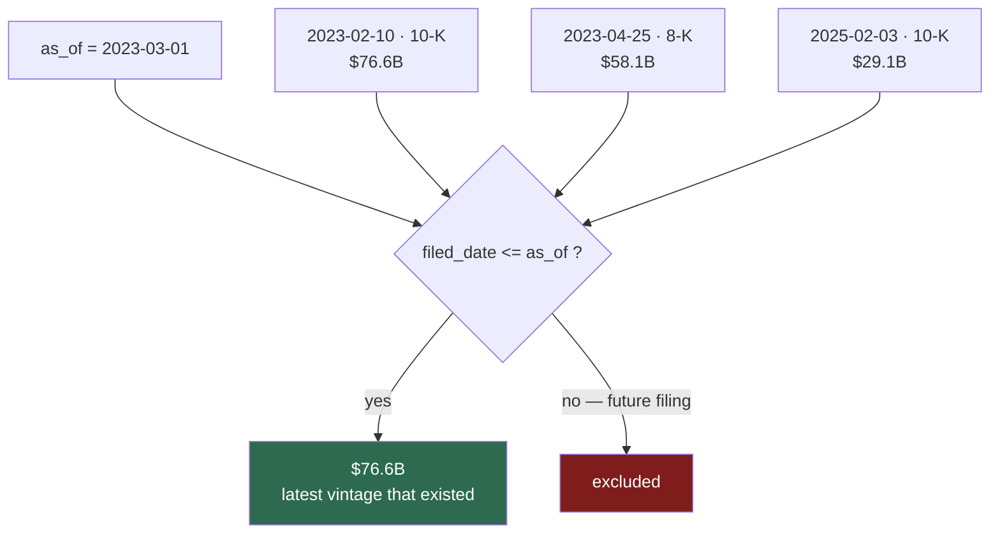
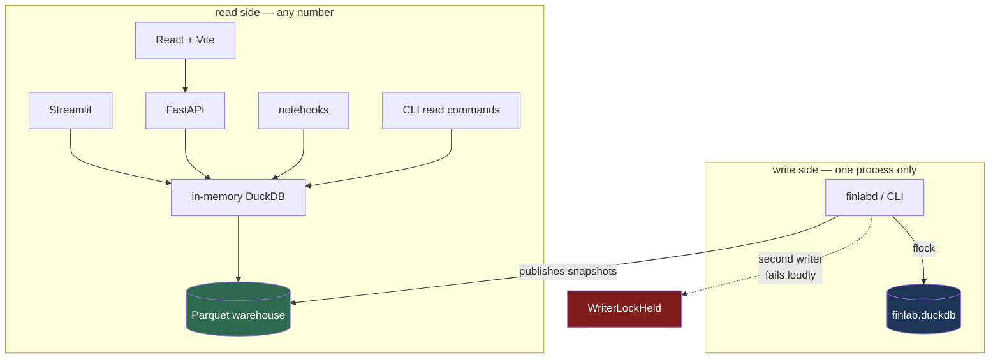
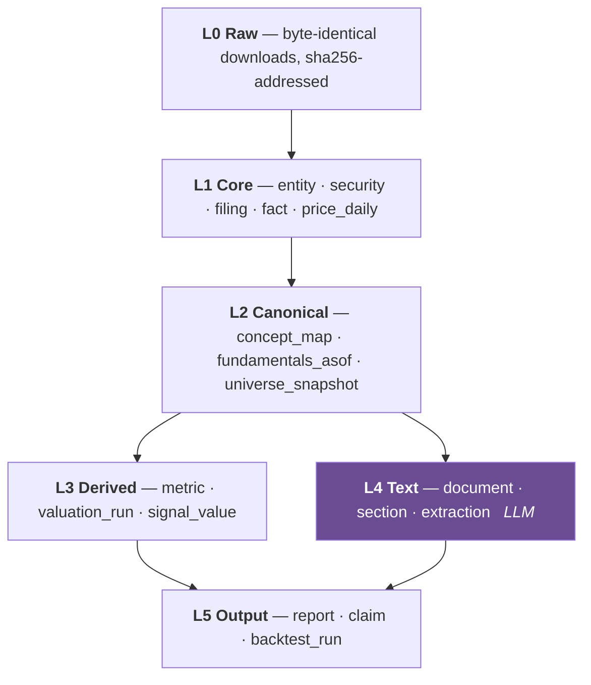
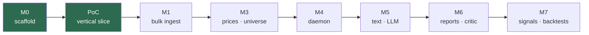

# finlab

Self-hosted financial research platform. It ingests SEC filings, computes
valuations deterministically, generates verified company reports, and provides a
rigorous environment for signal research — on one server, with no paid data
vendor and no cloud bill.

The design goal is narrower than it sounds: **make it structurally hard to fool
yourself.** Every fact carries the date it became public, every number in a
report has to trace back to a filing, and every backtest configuration you try
gets logged whether you like the result or not.

Full design: [`docs/architecture.md`](docs/architecture.md) ·
Working agreements for contributors, human or agent: [`CLAUDE.md`](CLAUDE.md)

---

## Weekly investment brief

Open the [offline example](examples/weekly-brief.html) in a browser to inspect a fictional edition. To generate a live edition, run the screen once and open **Weekly brief** in the dashboard.

```bash
make env
# In .env, set FINLAB_SEC_USER_AGENT to a real contact address.
# Set FINLAB_ALPACA_KEY_ID and FINLAB_ALPACA_SECRET_KEY for the free IEX feed.
uv sync --all-extras
uv run finlab weekly
make run
```

The screen covers the 54 US filers in the project's fixed universe. After the US trading week ends, it compares each company with SPY and identifies candidates for a 3–12 month research horizon. A week can have zero candidates. Each company shows its outcome, inputs, filing links and dated price history.

| A company must pass all four rules | Calculation |
| --- | --- |
| Annual earnings yield ≥ 4% | Latest reported fiscal-year diluted EPS in USD divided by the raw USD closing price |
| Annual sales growth > 0 | Latest annual revenue divided by comparable prior-year revenue, minus one |
| Positive relative momentum | Stock adjusted return from 52 to 4 weeks ago minus SPY’s return on the same dates |
| Maximum decline within 35% | Worst peak-to-trough decline between the last 53 weekly adjusted closes |

Qualifying names are ranked by earnings yield, then relative momentum. The maximum price compatible with the yield hurdle is diluted EPS divided by 0.04. The thresholds are research assumptions. The page shows median, worst and frequency of outperformance in up to twenty disjoint historical 13-week periods. These descriptive statistics cover all observed periods and do not measure the decision rule’s predictive accuracy. Fixed-universe selection, IEX-only pricing, annual accounting, cyclical earnings and USD/CAD exposure matter when interpreting a result.

**Data and timing.** The brief refreshes SEC Company Facts through the existing rate-limited client, resolves annual USD observations with the project's point-in-time macro and compares matching stock and SPY sessions. Annual figures older than 460 days, ambiguous split basis and incomplete weekly prices cannot qualify. The cutoff is Friday end-of-day New York, available Saturday. A delayed run can include vendor corrections made after Friday. The archive records its actual generation time. The writer publishes one immutable ZIP per week under `data/reports/weekly/`, containing the report, dated SEC citations and the daily prices used. Opening the UI runs no downloads.

**Weekly operation.** With both Alpaca keys set, the existing `finlabd` scheduler enqueues the report Saturdays at **12:00 UTC**. On first setup run `uv run finlab db init`, then `make daemon` on the host that should generate editions. A run that misses the trigger can be recovered with `uv run finlab weekly` after stopping the daemon to release the writer lock. The command prints the latest completed edition and reuses an existing edition on retry.

**Alternative price input.** Supply `uv run finlab weekly --prices-csv path/to/daily.csv`. Include one row per ticker and trading session with the columns `ticker,date,raw_close,split_close,adjusted_close`. Prices must be positive daily USD closes from the same provider and currency basis. Use raw prices, split-only adjusted prices and fully adjusted prices respectively. Include SPY, the desired members of the fixed universe, and preferably five years of history. SEC contact details are still required. CSV import is an on-demand path.

[Alpaca historical bars](https://docs.alpaca.markets/us/reference/stockbars) · [SEC Company Facts](https://www.sec.gov/search-filings/edgar-application-programming-interfaces) · [Momentum construction in Ken French’s Data Library](https://mba.tuck.dartmouth.edu/pages/faculty/ken.french/Data_Library/det_10_port_form_pr_12_2.html)

## Quick start

```bash
make setup
make env
# In .env, set FINLAB_SEC_USER_AGENT to a real contact address.
make app       # FastAPI on 8000 + React/Vite on 5173
```

For the Streamlit interface, use `make run` (`8501` by default). The React application is the primary web frontend and calls the read-only FastAPI backend; FastAPI exposes Swagger/OpenAPI at `http://127.0.0.1:8000/docs`.

`make` on its own lists every target.

| Target | Does |
| --- | --- |
| `app` | Launch FastAPI and React/Vite together |
| `api` | Launch the read-only FastAPI backend on `127.0.0.1:8000` |
| `web` | Launch React/Vite on `127.0.0.1:5173` |
| `run` / `ui` | Launch the legacy Streamlit UI on `127.0.0.1:8501` |
| `bootstrap` | Fresh clone → setup, ingest, concepts, metrics, and universe snapshot |
| `check` | Lint + tests — the pre-push gate |
| `test` `lint` `fmt` | Run checks individually |
| `coverage` | Concept resolution report; exits non-zero below 95% |
| `status` | Schema version, table names and row counts |
| `ingest` `concepts` `metrics` | Pipeline stages on their own |
| `prices-yahoo` | Merge Yahoo raw OHLCV into the warehouse (`START` and `END`, ISO dates) |
| `clean` `clean-data` | Caches; warehouse and DB, keeping raw downloads |

Override defaults inline: `make run PORT=9000`, `make metrics AS_OF=2024-01-01`.

---

## What's in it right now

A proof-of-concept vertical slice: real code paths, deliberately narrow universe.

| | |
| --- | --- |
| Universe | 54 large-cap filers, 11 GICS-like sectors, pinned by CIK |
| Facts | 1,511,785 observations, filed 2009-05-07 → 2026-07-31 |
| Filings | 9,226 |
| Canonical concepts | 12, from 40 us-gaap tag mappings |
| Derived Q4 rows | 10,920 |
| Disk | 21 MB warehouse · 15 MB raw · 7.6 MB database |
| Tests | 120, zero skipped |

Stack: Python 3.12, DuckDB 1.5, Parquet, Polars, FastAPI, Streamlit, React 19, TypeScript, Vite, `uv`, `npm`.

---

## How the data flows



The split between `parse_companyfacts` and the fetch layer is load-bearing: M1's
bulk loader streams the same documents out of `companyfacts.zip` and reuses the
parser and writer **unchanged**. Only the source differs.

---

## The two rules that matter most

### Point-in-time, or nothing

Every fundamentals read goes through `fundamentals_asof(as_of)`, whose single
`WHERE f.filed_date <= as_of` is the difference between a real backtest and a
fantasy. Nothing reads the `fact` table directly.

Restatements are preserved by construction — `filed_date` and
`accession_number` are both part of the logical key, so an old value is never
overwritten. Ask for a date and you get what was knowable *then*:



That is General Electric's FY2022 revenue, CIK 40545, and all three values are
real. Move the UI's as-of slider from 2023 to 2025 and the same cell falls from
**$76.6B to $29.1B** — a 62% cut to an already-closed year, caused by the GE
HealthCare and GE Vernova spin-offs being reclassified into discontinued
operations. The Restatement explorer page renders exactly this.

`tests/test_pit.py` enforces the property against random `(cik, as_of)` probes
and **may not be weakened or skipped.**

### Exactly one writer



`write_conn()` takes an OS-level advisory lock, so a second writer gets a clear
error instead of corrupting anything. Readers never open the database file at
all — which is why the UI keeps serving mid-ingest. `tests/test_read_path.py`
proves it by holding the lock in one process and querying from another.

Small tables (`entity`, `filing`, `security`, …) live natively in DuckDB *and*
get snapshotted to Parquet, because readers are forbidden from opening the
database and would otherwise have no way to resolve a CIK to a company name.

---

## Layers



L1–L3 run over the entire universe daily for free. **L4 is the only layer that
spends inference quota**, and the only one an LLM touches at all — ratios,
screens, signals and backtests are SQL and NumPy. A number that appears in a
report was computed, never generated.

---

## Repository layout

```text
src/finlab/
  config.py        settings — pydantic-settings over .env
  cli.py           typer entrypoint: db · ingest · concepts · metrics · ui · api
  data/            poc_universe.yaml · concept_map.yaml   (hand-maintained)
  db/              conn · schema.sql · migrations · keys
  ingest/          sec · companyfacts · warehouse · universe · prices
  core/            concepts · pit · metrics · valuation      (valuation: M6)
  api/             app.py                              read-only FastAPI backend
  text/            fetch · sections · schemas · extract      (M5)
  report/          bundle · compose · critic                 (M6)
  research/        signals · backtest · stats                (M7)
  daemon/          main · scheduler · queue · pools          (M4)
  ui/              app.py · queries.py                       (legacy)
```
### Schema and migrations

`db/schema.sql` is the baseline a fresh install applies; `db/migrations/NNNN_*.sql`
are forward-only deltas for existing databases. Changing the schema means doing
**both**. They cannot drift: `tests/test_schema_drift.py` builds one database
from the baseline and another by replaying every migration from empty, then
asserts the columns, constraints and indexes match exactly.

---

## Roadmap



Green is shipped. The PoC slice covers ingestion, the concept map, the
point-in-time layer, eight ratios and the UI — end to end on 54 companies.
M7 is where projects like this usually die; it is deliberately last.

---

## Known limitations

**Prices are unavailable.** Stooq now gates its bulk archive behind a JavaScript
proof-of-work challenge and returns 401 on the static mirror. The loader detects
this and stops with instructions rather than working around it — defeating a
site's anti-bot control is not something this project does. The parser is
complete and tested against a locally downloaded archive
(`finlab ingest prices --archive path/to/d_us_txt.zip`). Consequence: **market
cap is empty**; every other figure is fundamentals-only and unaffected.

**Four concepts sit below the 95% coverage bar** — `cogs` 69%, `gross_profit`
69%, `total_debt` 77%, `capex` 89%. This is mostly accounting, not a mapping
gap: 13 of the 54 companies (seven Financials, plus Berkshire, Comcast, Disney,
Exxon, Union Pacific, Prologis, NextEra) never tag cost of goods sold at all,
which caps `cogs` at roughly 76%. `total_liabilities` was rescued from 67% to
99% by deriving it from `total_assets − equity`. A uniform threshold across
concepts that don't uniformly exist is the wrong test; per-concept thresholds
are the open question.

**`pyarrow` is capped below 25.** Version 25.0.0 segfaults converting a
DataFrame to Arrow on Streamlit's script thread, killing the app on the first
slider move — reproducible with a five-line Streamlit app and no finlab code.
The cap is load-bearing and a test asserts it.

**`accepted_at` is NULL.** companyfacts doesn't carry the intraday acceptance
timestamp; it comes from the EDGAR submissions index. Same-day signal timing
depends on it, so M1 must fill it before M7 is trustworthy.
