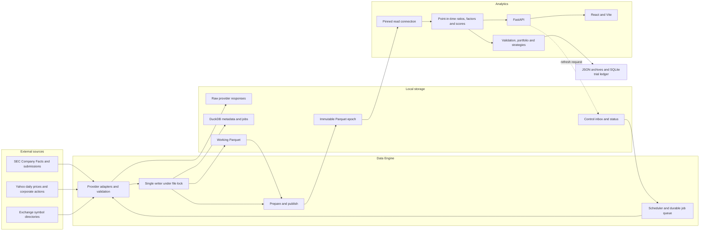
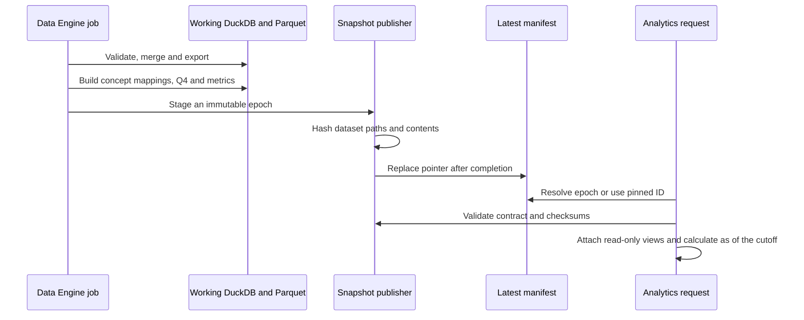
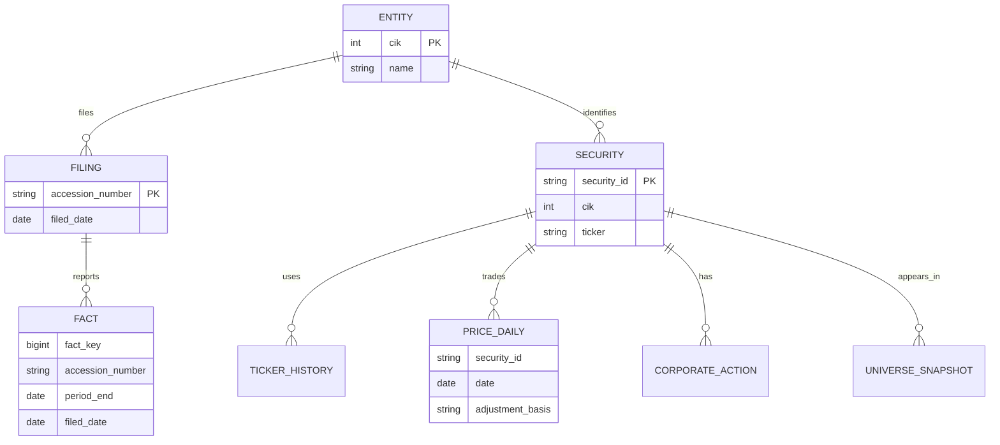

# FinLab architecture

FinLab runs as two local applications over a versioned Parquet warehouse. The
Data Engine ingests external data and owns the financial DuckDB write lock.
Analytics reads a chosen publication in an in-memory DuckDB connection and serves
deterministic research through FastAPI and React. The reporting and backtest ledger
live outside the financial database.

[Source code guide](code_guide.md) · [Scoring V2](scoring_v2.md) ·
[Research methodology and results](validation_v3.md) · [Frontend architecture](../frontend/README.md) · [V4 product guide](product_v4.md)

## Running system



| Area | Running responsibilities |
| --- | --- |
| Ingestion | SEC Company Facts, submissions, dated universe snapshots, daily Yahoo OHLCV and corporate actions. Stooq bulk ingestion requires a compatible local archive. Alpaca and other historical adapters are separate from the published research API. |
| Financial storage | The writer maintains native metadata and emits working Parquet. Facts and daily prices are accessed through explicit per-dataset Parquet views. |
| Publication | A unique epoch contains immutable files. The publisher copies mutable inputs into a content-addressed object store and links epoch files to the immutable objects. A completed epoch and checksums precede the atomic update of `snapshots/latest.json`. |
| Analytics | Pinned publication checks, canonical point-in-time facts, V2 company scores, separate legacy ranking and recommendation archives, portfolio analysis, strategies and V3 validation. |
| Presentation | Vite proxies `/api` to FastAPI. The shell groups research, personal tools and operations. The refresh route writes a request to the control inbox for the engine. Portfolio trades are kept in browser-owned storage and are passed to Analytics only for validation or calculation. |
| Optional and historical code | The deterministic application runs without an LLM. The older text, valuation and report design below includes placeholders and longer-term ideas. The source guide marks these explicitly. |

## Read and publication lifecycle



The contract requires `entity`, `filing`, `security`, `concept_map`,
`fundamentals_q4` and `metric`. Facts, prices, actions, dated universe,
price ingestion and ticker history have independent availability. Hashes
verify file integrity. Financial coverage is evaluated separately in Analytics.
Unsuitable publications return HTTP 503 on warehouse-dependent routes.
A reader remains pinned while a new epoch is published. There is no
automatic retention policy. Keep epochs and code bundles referenced by research.

## Data identities



These are conceptual relationships across storage locations. The security
catalogue also holds directory entries without a matching SEC issuer. Likewise,
the large fact and price datasets use logical keys and published Parquet views.
Numbered migrations and the baseline schema remain the source of truth for
physical constraints.

## Scheduling and failure handling

The engine schedules prices and universe snapshots at 18:30 New York time on
weekdays. The loader resolves the last completed market session. SEC discovery
runs at 07:00 UTC, acceptance metadata at 07:30 and derived rebuilds at 08:00.
Sunday jobs refresh company facts and check coverage. The first Sunday also
schedules a historical price correction audit. Engine restarts reclaim
interrupted jobs and enqueue price catch-up. Missed symbol-directory observations
cannot be reconstructed from today's directory. The separate Analytics
`research-daemon` schedules the weekly report for Saturday at noon UTC.

See [deployment](../deploy/README.md) for systemd and launchd templates, and the
[source guide](code_guide.md) for the command and HTTP contracts.

## Original design archive

The original schema and product design follows. It preserves historical
decisions and proposals, including earlier publication, cloud inference and
feature status descriptions. For current behavior use the sections above and
the linked implementation guides.

### Original architecture and schema design

**Target host:** 1 server, 16 GB RAM, 500 GB SSD
**Inference:** Ollama Cloud Pro (3 concurrent models, 5h session / 7d weekly quotas)
**Everything else:** free / open source

---

## 0. Design principles

1. **Deterministic by default.** Financial math, screening, ranking and backtests are SQL and NumPy. LLMs touch only unstructured text. If a number appears in a report, it was computed, never generated.
2. **Point-in-time or nothing.** Every fact carries the date it became public. No query may read a value that did not exist at its `as_of_date`.
3. **Immutable raw, reproducible derived.** Raw bytes are written once, hashed, never edited. Every derived row carries `code_version` + `inputs_hash` so it can be invalidated and rebuilt.
4. **RAM is the constraint, not disk.** DuckDB `memory_limit = 9GB`. Aggregate in SQL; never materialise a full table into pandas.
5. **Trials are logged.** Every backtest configuration tested is recorded, because the deflated Sharpe ratio needs the trial count. Multiple-testing discipline is structural, not aspirational.

---

## 1. Physical layout

```text
/data
  /raw/                     immutable, gzip, named by sha256
    companyfacts/2026-08-02/companyfacts.zip
    filings/{cik}/{accession}/{doc}.htm.gz
    prices/stooq/2026-08-02/
  /staging/                 transient parquet, safe to delete
  /warehouse/               hive-partitioned parquet (the lake)
    fact/taxonomy=us-gaap/filed_year=2025/*.parquet
    price_daily/year=2025/*.parquet
  /db/
    finlab.duckdb           small tables, views, metadata, job queue
  /reports/{cik}/{as_of}.md
  /mlruns/                  MLflow file backend
```

**Rule of thumb:** anything under ~50M rows and frequently joined lives *inside* DuckDB. Anything larger or append-only lives as Parquet and is read through a view. `fact` and `price_daily` are Parquet; everything else is native.

**Disk estimate:** companyfacts as Parquet ≈ 8–15 GB, 25 y of daily OHLCV for the full US market ≈ 2 GB, extracted filing sections ≈ 20–40 GB, raw filing HTML if hoarded ≈ 200 GB+ (**don't** — keep raw only for the last 8 quarters, then prune to extracted sections). Steady state ≈ 60–80 GB.

---

## 2. Layer map

| Layer | Contents | LLM? |
| --- | --- | --- |
| L0 Raw | byte-identical downloads, sha256-addressed | no |
| L1 Core | `entity`, `filing`, `fact`, `security`, `price_daily`, `corporate_action` | no |
| L2 Canonical | `concept_map`, `fundamentals_pit` (view), `universe_snapshot` | no |
| L3 Derived | `metric`, `valuation_run`, `signal_value` | no |
| L4 Text | `document`, `document_section`, `extraction` | **yes** |
| L5 Output | `report`, `claim`, `backtest_run`, `backtest_metric` | partial |
| Presentation | FastAPI read-only routes and React/Vite market workstation | no |

L1–L3 can run over the entire universe every day for free. L4 is the only layer that spends quota. Presentation clients never open the write DuckDB connection: FastAPI Analytics uses read-only/in-memory readers, and React communicates only with HTTP routes.

FastAPI routes are implemented in `src/finlab/api/app.py`: `GET /api/health`, `GET /api/universe`, and `GET /api/market/live`. The React 19/TypeScript/Vite source lives in `frontend/` and proxies `/api/*` to FastAPI during development. The React application is launched through `make start`.

---

## 3. Core schema

### 3.1 `entity` — one row per SEC filer

CIK is the durable key. Tickers change, CIKs do not.

```sql
CREATE TABLE entity (
  cik            INTEGER PRIMARY KEY,
  name           VARCHAR NOT NULL,
  sic            INTEGER,
  sector          VARCHAR,          -- derived from SIC
  industry        VARCHAR,
  country_inc     VARCHAR,
  fiscal_year_end VARCHAR,          -- 'MMDD', e.g. '1231'
  first_filing    DATE,
  last_filing     DATE,
  is_active       BOOLEAN,
  updated_at      TIMESTAMP
);
```

### 3.2 `security` — tradable line, with delisting

Separated from `entity` because one filer can have multiple share classes (GOOG/GOOGL) and because delisting is a *security* event, not an entity event.

```sql
CREATE TABLE security (
  security_id     VARCHAR PRIMARY KEY,   -- stable synthetic, e.g. 'US:0000320193:AAPL'
  cik             INTEGER REFERENCES entity(cik),
  ticker          VARCHAR NOT NULL,
  exchange        VARCHAR,
  share_class     VARCHAR,
  currency        VARCHAR DEFAULT 'USD',
  first_date      DATE,
  last_date       DATE,                  -- NULL if still listed
  delisting_date  DATE,
  delisting_reason VARCHAR,              -- 'acquired','bankrupt','deregistered','moved'
  is_active       BOOLEAN
);
```

Tickers get recycled (a bankrupt company's ticker reassigned years later), so **never join on ticker**. Resolve ticker → `security_id` through a validity range:

```sql
CREATE TABLE ticker_history (
  ticker      VARCHAR,
  security_id VARCHAR REFERENCES security(security_id),
  valid_from  DATE,
  valid_to    DATE,          -- '9999-12-31' if current
  PRIMARY KEY (ticker, valid_from)
);
```

### 3.3 `filing` — one row per SEC submission

```sql
CREATE TABLE filing (
  accession_number  VARCHAR PRIMARY KEY,  -- '0000320193-25-000073'
  cik               INTEGER REFERENCES entity(cik),
  form              VARCHAR NOT NULL,     -- '10-K','10-Q','8-K','DEF 14A'
  filed_date        DATE NOT NULL,        -- ★ the PIT anchor
  accepted_at       TIMESTAMP,            -- intraday; matters for same-day signals
  period_of_report  DATE,
  fiscal_year       INTEGER,
  fiscal_period     VARCHAR,              -- 'FY','Q1','Q2','Q3'
  is_amendment      BOOLEAN,
  amends_accession  VARCHAR,
  primary_doc_url   VARCHAR,
  raw_path          VARCHAR,
  raw_sha256        VARCHAR
);
CREATE INDEX filing_cik_filed ON filing(cik, filed_date);
```

`accepted_at` matters: a 10-K accepted at 16:45 ET cannot inform a trade at that day's close. Signals should lag to the next open.

### 3.4 `fact` — the point-in-time XBRL store

**This is the heart of the system.** Grain: one row per *reported observation*, not per period. The same fiscal period reported in three successive filings produces three rows. That redundancy **is** the restatement history and must be preserved.

```sql
CREATE TABLE fact (
  cik              INTEGER  NOT NULL,
  taxonomy         VARCHAR  NOT NULL,   -- 'us-gaap','ifrs-full','dei','srt'
  tag              VARCHAR  NOT NULL,   -- 'Revenues','Assets'
  unit             VARCHAR  NOT NULL,   -- 'USD','shares','USD-per-shares'
  period_start     DATE,                -- NULL for instant (balance sheet) facts
  period_end       DATE     NOT NULL,
  duration_days    INTEGER,             -- NULL = instant; else period_end - period_start
  duration_bucket  VARCHAR,             -- 'instant','quarter','half','ytd9','annual','other'
  value            DOUBLE   NOT NULL,
  accession_number VARCHAR  NOT NULL,
  form             VARCHAR,
  fiscal_year      INTEGER,
  fiscal_period    VARCHAR,
  filed_date       DATE     NOT NULL,   -- ★ PIT key
  frame            VARCHAR,             -- SEC's calendar-aligned frame, when present
  PRIMARY KEY (cik, taxonomy, tag, unit, period_end, period_start, accession_number)
);
```

Partition the Parquet by `taxonomy` / `filed_year`. Sort within each file by `cik, tag, period_end` so DuckDB's row-group statistics prune hard on single-company queries.

**Three traps this schema is built to survive:**

- *YTD contamination.* A 10-Q reports `Revenues` for both the 3-month and the 9-month window. Without `duration_bucket` you will silently sum them. Bucket by `duration_days`: 80–100 → `quarter`, 170–190 → `half`, 260–285 → `ytd9`, 350–380 → `annual`.
- *Missing Q4.* Q4 is never filed as a standalone quarter. For flow items, `Q4 = FY − (Q1+Q2+Q3)`. Balance-sheet items are instants, so they're unaffected. Materialise this in L2, not in ad-hoc queries.
- *Restatement.* Preserved by construction — `filed_date` in the key means the old value is still there.

### 3.5 `concept_map` — the tag normalisation layer

The single most underestimated piece. "Revenue" appears as `Revenues`, `RevenueFromContractWithCustomerExcludingAssessedTax`, `SalesRevenueNet`, `RevenueFromContractWithCustomerIncludingAssessedTax`… varying by company *and* by year.

```sql
CREATE TABLE concept_map (
  canonical   VARCHAR NOT NULL,   -- 'revenue','net_income','total_assets','fcf'
  taxonomy    VARCHAR NOT NULL,
  tag         VARCHAR NOT NULL,
  priority    INTEGER NOT NULL,   -- 1 = most preferred
  sign        SMALLINT DEFAULT 1, -- -1 where the tag is reported with opposite sign
  valid_from  DATE DEFAULT '1900-01-01',
  valid_to    DATE DEFAULT '9999-12-31',
  PRIMARY KEY (canonical, taxonomy, tag, valid_from)
);
```

Resolution rule: for each `(cik, canonical, period)`, take the lowest-priority tag that is actually present. Start with ~30 canonical concepts covering the three statements; that's enough for every ratio and DCF input.

Add a coverage check to CI: *for the top 1000 companies by market cap, what fraction of company-quarters resolve each canonical concept?* Anything below ~95 % means a missing tag mapping, and it will silently corrupt cross-sectional screens.

### 3.6 The PIT view

```sql
CREATE MACRO fundamentals_asof(as_of) AS TABLE
  SELECT * FROM (
    SELECT
      f.cik, cm.canonical, f.period_start, f.period_end,
      f.duration_bucket, f.value * cm.sign AS value,
      f.filed_date, f.accession_number,
      ROW_NUMBER() OVER (
        PARTITION BY f.cik, cm.canonical, f.period_end, f.duration_bucket
        ORDER BY f.filed_date DESC, cm.priority ASC, f.accession_number DESC
      ) AS rn
    FROM fact f
    JOIN concept_map cm
      ON cm.taxonomy = f.taxonomy AND cm.tag = f.tag
     AND f.filed_date BETWEEN cm.valid_from AND cm.valid_to
    WHERE f.filed_date <= as_of          -- ★ the only line preventing look-ahead
  ) WHERE rn = 1;
```

Every downstream consumer goes through this macro. Nothing reads `fact` directly. That single `WHERE` is the difference between a real backtest and a fantasy.

### 3.7 Prices and corporate actions

```sql
CREATE TABLE price_daily (
  security_id VARCHAR NOT NULL,
  date        DATE    NOT NULL,
  open        DOUBLE, high DOUBLE, low DOUBLE, close DOUBLE,
  volume      BIGINT,
  source      VARCHAR,
  PRIMARY KEY (security_id, date)
);

CREATE TABLE corporate_action (
  security_id VARCHAR NOT NULL,
  ex_date     DATE    NOT NULL,
  action_type VARCHAR NOT NULL,   -- 'split','cash_dividend','spinoff'
  factor      DOUBLE,             -- 2.0 for a 2:1 split
  amount      DOUBLE,             -- dividend per share
  PRIMARY KEY (security_id, ex_date, action_type)
);
```

Store **raw** OHLCV, never a vendor's `adj_close`. Adjustment factors are retroactively restated; deriving them from `corporate_action` lets you reconstruct the adjusted series as-of any date. In practice splits are known immediately so this matters less than it does for fundamentals — but it costs nothing to be correct.

### 3.8 Universe snapshots — your defence against survivorship bias

```sql
CREATE TABLE universe_snapshot (
  snapshot_date DATE    NOT NULL,
  security_id   VARCHAR NOT NULL,
  exchange      VARCHAR,
  is_common     BOOLEAN,
  market_cap    DOUBLE,
  PRIMARY KEY (snapshot_date, security_id)
);
```

Populate daily from the Nasdaq Trader symbol directory. This is the one dataset money can't easily buy for free retroactively — **start capturing it on day one**, even before the rest of the pipeline works. In two years you'll have a clean PIT universe nobody can hand you now.

Until then, every pre-2026 backtest is survivorship-contaminated and must be labelled as such in `backtest_run.caveats`.

---

## 4. Derived layer

```sql
CREATE TABLE metric (
  cik          INTEGER NOT NULL,
  as_of_date   DATE    NOT NULL,
  metric_name  VARCHAR NOT NULL,   -- 'roic','fcf_margin','piotroski_f','ev_ebitda'
  value        DOUBLE,
  inputs_hash  VARCHAR,            -- hash of the source fact rows
  code_version VARCHAR,            -- git sha of the metric module
  computed_at  TIMESTAMP,
  PRIMARY KEY (cik, as_of_date, metric_name)
);

CREATE TABLE valuation_run (
  run_id       VARCHAR PRIMARY KEY,
  cik          INTEGER NOT NULL,
  as_of_date   DATE    NOT NULL,
  method       VARCHAR NOT NULL,   -- 'reverse_dcf','dcf_grid','peer_regression'
  assumptions  JSON,               -- wacc range, terminal g range, horizon
  output       JSON,               -- implied growth, fair value grid, residual
  inputs_hash  VARCHAR,
  code_version VARCHAR,
  computed_at  TIMESTAMP
);
```

`inputs_hash` + `code_version` give you cheap invalidation: when a restatement lands or a metric's code changes, recompute only the affected rows.

---

## 5. Text layer (the only place quota is spent)

```sql
CREATE TABLE document (
  accession_number VARCHAR PRIMARY KEY REFERENCES filing(accession_number),
  doc_type         VARCHAR,
  url              VARCHAR,
  raw_path         VARCHAR,
  raw_sha256       VARCHAR,
  char_count       INTEGER,
  fetched_at       TIMESTAMP
);

CREATE TABLE document_section (
  section_id       VARCHAR PRIMARY KEY,     -- sha256(accession || item_code)
  accession_number VARCHAR REFERENCES document(accession_number),
  cik              INTEGER,
  item_code        VARCHAR,                 -- '1','1A','7','7A','8'
  title            VARCHAR,
  text             VARCHAR,
  text_sha256      VARCHAR NOT NULL,        -- ★ cache key
  token_estimate   INTEGER,
  char_start       INTEGER,
  char_end         INTEGER
);

CREATE TABLE extraction (
  extraction_id  VARCHAR PRIMARY KEY,
  text_sha256    VARCHAR NOT NULL,          -- ★ not section_id
  schema_name    VARCHAR NOT NULL,          -- 'risk_factors','segment_revenue','guidance'
  schema_version INTEGER NOT NULL,
  model          VARCHAR NOT NULL,
  prompt_sha256  VARCHAR NOT NULL,
  output         JSON,
  valid          BOOLEAN,                   -- passed Pydantic validation
  input_tokens   INTEGER,
  output_tokens  INTEGER,
  latency_ms     INTEGER,
  created_at     TIMESTAMP,
  UNIQUE (text_sha256, schema_name, schema_version, model, prompt_sha256)
);
```

**Why `text_sha256` and not `section_id` is the cache key:** a boilerplate risk-factor section repeated verbatim across four quarters hashes identically, so it's extracted once and served from cache three times. The quarter-over-quarter diff optimisation is built into the key rather than bolted on as a separate step.

Never send a whole 10-K. Split on `Item` headers first — Item 7 alone is 15–25k tokens versus 150–500k for the full filing.

### Model routing

| Job | Model | Rationale |
| --- | --- | --- |
| Section classification, boilerplate detection | `gpt-oss:20b` | high volume, trivial task |
| Structured field extraction | `gpt-oss:120b` | accuracy on segment tables matters |
| Report narrative synthesis | `gpt-oss:120b` / `deepseek-v3.1` | once per report |
| Critic / numeric verification | `gpt-oss:20b` | high volume, mechanical |

---

## 6. Output layer

```sql
CREATE TABLE report (
  report_id        VARCHAR PRIMARY KEY,
  cik              INTEGER NOT NULL,
  as_of_date       DATE    NOT NULL,
  template_version VARCHAR,
  fact_bundle      JSON,      -- every number the composer was allowed to use
  markdown         VARCHAR,
  status           VARCHAR,   -- 'draft','verified','rejected'
  created_at       TIMESTAMP
);

CREATE TABLE claim (
  claim_id     VARCHAR PRIMARY KEY,
  report_id    VARCHAR REFERENCES report(report_id),
  claim_text   VARCHAR,
  numeric_value DOUBLE,
  unit         VARCHAR,
  cited_key    VARCHAR,    -- path into fact_bundle, e.g. 'metrics.roic.2025Q4'
  verdict      VARCHAR,    -- 'match','mismatch','unsupported'
  delta        DOUBLE
);
```

The composer receives `fact_bundle` and is instructed that any number not present in it is forbidden. The critic re-extracts every numeric claim from the draft and checks it against the bundle. A report with any `unsupported` or `mismatch` claim never reaches `verified`. This loop is the difference between a demo and something you'd act on.

---

## 7. Research layer

```sql
CREATE TABLE signal (
  signal_id       VARCHAR PRIMARY KEY,
  name            VARCHAR,
  definition_sql  VARCHAR,
  definition_hash VARCHAR,
  code_version    VARCHAR
);

CREATE TABLE signal_value (
  signal_id   VARCHAR NOT NULL,
  security_id VARCHAR NOT NULL,
  as_of_date  DATE    NOT NULL,
  raw_value   DOUBLE,
  zscore      DOUBLE,
  sector_neutral_z DOUBLE,
  PRIMARY KEY (signal_id, security_id, as_of_date)
);

CREATE TABLE research_trial (        -- ★ multiple-testing ledger
  trial_id     VARCHAR PRIMARY KEY,
  signal_id    VARCHAR,
  config_hash  VARCHAR,
  created_at   TIMESTAMP,
  note         VARCHAR
);

CREATE TABLE backtest_run (
  run_id          VARCHAR PRIMARY KEY,
  signal_id       VARCHAR,
  universe_def    VARCHAR,
  start_date      DATE, end_date DATE,
  rebalance       VARCHAR,          -- 'monthly','quarterly'
  cost_bps        DOUBLE,
  slippage_model  VARCHAR,
  config          JSON,
  git_sha         VARCHAR,
  n_prior_trials  INTEGER,          -- feeds the deflated Sharpe
  caveats         VARCHAR,          -- e.g. 'survivorship-contaminated pre-2026'
  created_at      TIMESTAMP
);

CREATE TABLE backtest_metric (
  run_id      VARCHAR REFERENCES backtest_run(run_id),
  metric_name VARCHAR,              -- 'sharpe','deflated_sharpe','max_dd','turnover'
  value       DOUBLE,
  PRIMARY KEY (run_id, metric_name)
);
```

`research_trial` is inserted **before** each backtest, not after. `n_prior_trials` is read from it at run time. This makes it structurally awkward to forget how many configurations you've already tried, which is the mechanism by which most people fool themselves.

---

## 8. Orchestration

No Airflow, no Dagster — both cost ~1 GB of RAM to do nothing. A job table plus cron plus a worker process.

```sql
CREATE TABLE job (
  job_id     VARCHAR PRIMARY KEY,
  job_type   VARCHAR NOT NULL,     -- 'fetch_filing','extract','compose','backtest'
  payload    JSON,
  priority   INTEGER DEFAULT 100,  -- lower runs first
  state      VARCHAR DEFAULT 'pending',
  attempts   INTEGER DEFAULT 0,
  not_before TIMESTAMP,            -- exponential backoff
  locked_by  VARCHAR,
  locked_at  TIMESTAMP,
  error      VARCHAR,
  created_at TIMESTAMP,
  updated_at TIMESTAMP
);
```

State machine: `pending → running → done | failed | deadletter`. Retry with backoff via `not_before`; three strikes to `deadletter`.

**Concurrency:** the LLM worker pool is a semaphore of exactly **3** — matching the Pro tier limit. Requests beyond it are queued server-side with finite depth, so overshooting yields rejections rather than backpressure. Three workers plus a retry-on-429 wrapper is the entire design. Quota exhaustion is a retry, never a crash.

**Earnings-season smoothing:** filings arrive in bursts — 400+ in a three-week window against a ~4,000/year steady state. Priority-rank by watchlist membership and let the queue spread the rest across following days. The deterministic screening layer runs at full universe scale daily regardless, since it costs nothing.

### Schedule

| Cadence | Job |
| --- | --- |
| Daily 06:00 | universe snapshot, prices, EDGAR daily index |
| Daily 07:00 | new filings → fetch → section split → enqueue extractions |
| Daily 08:00 | L2/L3 rebuild for affected CIKs, full-universe screen |
| Continuous | 3 LLM workers draining the extraction queue |
| Weekly | full companyfacts refresh, concept coverage check |
| On demand | valuation runs, report composition, backtests |

### Presentation processes

- FastAPI listens on `127.0.0.1:8000` and exposes `/api/health`, `/api/universe`, and `/api/market/live`.
- Vite listens on `127.0.0.1:5173` and proxies `/api/*` to FastAPI.
- Streamlit is retired and is not an application entry point.
- `make app` starts FastAPI and Vite together; `make api` and `make web` start them independently.

These processes do not open `finlab.duckdb` read-write. They follow the in-memory reader or Parquet paths defined above.

---

## 9. Data Engine / Analytics split

| Data Engine | SEC/market ingestion, queue, writer, warehouse and snapshot publication | no |
| Analytics | Read-only PIT/metrics/factors/backtests/reports and React/FastAPI presentation | no |

The Data Engine owns `write_conn()`, provider adapters, raw caches, staging, Parquet publication and the OS writer lock. Analytics owns read-only/in-memory DuckDB access and must not import SEC, Alpaca, Stooq or Yahoo adapters.

A published warehouse epoch is represented by `data/warehouse/snapshots/{epoch}.json` plus `latest.json`. The contract includes `contract_version`, `schema_version`, publication time, required dataset presence and per-dataset checksums. Analytics validates this manifest before consuming a snapshot.

## Publication contract v2 (verified implementation, 2026-11-21)

This addendum supersedes the earlier manifest-only publication description.
The engine publisher must run under the existing single-writer lock. It copies
working datasets into a unique staging epoch, computes checksums on those
copies, renames the completed epoch into `warehouse/snapshots/{epoch}/`, then
atomically replaces `latest.json`. Published files are never updated by ingestion.
Epoch identifiers include microseconds and a UUID, avoiding same-second collisions.

The three warehouse-backed FastAPI routes validate contract version, required
dataset status, epoch path and checksums, then attach all views to that epoch.
A connection stays pinned across later publications. Missing, legacy v1 or corrupt
publication returns HTTP 503; the frontend displays the error. Republish with
`uv run finlab-engine publish` after upgrading. No database migration is needed.
The API health route remains available without data.

Engine derivations retain the existing working-dataset reader. This change does
not migrate all legacy CLI/research consumers to pinned epochs; weekly research
still requires a separate warehouse-only refactor. Publication validates integrity
and presence, not financial completeness or semantic data quality. The caller
must finish ingestion and native table exports before publication.

Copies consume additional disk space per epoch; automatic retention and
content-addressed deduplication are outstanding. Do not delete an epoch used by
an active reader. Checksums currently require a full scan on each API request;
this favors integrity over latency until a safe validation cache is implemented.
The publisher handles process interruptions by leaving the old latest pointer
usable; power-loss durability with explicit filesystem fsync is not implemented.

The older cloud-inference and deployment descriptions are historical design
material. Deterministic engine/API operation does not require an LLM. Backtest,
signal and research-statistics modules remain stubs; portfolio intelligence is
not implemented. Consult `technical_audit.md` before treating design sections as
operational capabilities.

### Incremental price recovery

`finlab-engine sync-prices` and the daemon price handler share
`ingest/price_sync.py`. Each security's latest persisted observation determines
its next download start, minus `FINLAB_PRICE_CORRECTION_OVERLAP_DAYS` calendar
days. A security without prices starts at `FINLAB_PRICE_HISTORY_START`. The
planner groups equal windows and queries only aggregate watermarks in DuckDB.
This recovers missing tails after outages longer than ten days without repeatedly
requesting twenty years for already populated securities.

Missing symbols fail the job so the durable queue can retry. Already merged rows
remain and are deduplicated on retry. Corporate-action download happens before
price persistence so that a failed action request does not advance the recovery
anchor. This does not guarantee that a partially returned symbol has all expected
sessions; session-gap checks and action persistence transactions are still open.
The existing loader still rewrites full local history, even though downloads are
incremental. Neither the command nor handler publishes an epoch automatically.
