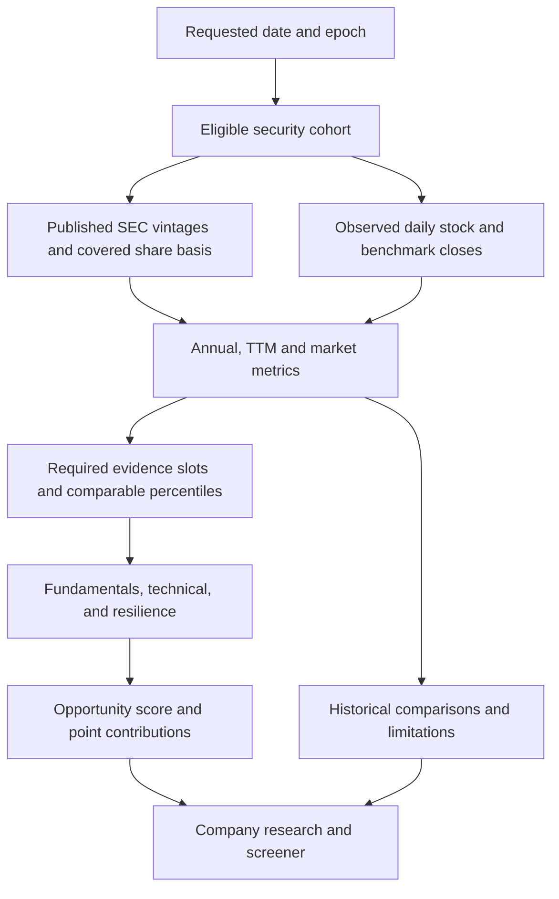

# FinLab source code guide

This guide maps source modules to their responsibilities and normal entry
points. See [architecture](architecture.md) for the service and storage
boundaries, [Scoring V2](scoring_v2.md) for the score, and
[V3 validation](validation_v3.md) for investment signal research.

## Python entry points and configuration

| Source | Responsibility |
| --- | --- |
| `src/finlab/config.py` | Validated `FINLAB_` settings, paths, provider quotas and research weights. |
| `src/finlab/cli.py` | Compatibility CLI for database initialization and migrations, historical ingestion, concepts, metrics, weekly reports and API startup. |
| `src/finlab/engine/cli.py` | `status`, `prepare`, `publish`, `sync-prices` and `sync`. |
| `src/finlab/analytics/cli.py` | `serve`, `status`, `recommend`, `evaluate`, `replay`, `portfolio`, `backtest`, `walk-forward`, `weekly`, `research-daemon`, `validate-scores` and `validate-signals`. |
| `src/finlab/data/*.yaml` | Canonical US GAAP concept rules and selectable security profiles. The default is `major_us_universe.yaml`. Current profiles do not supply historical index membership. |
| `pyproject.toml`, `uv.lock`, `Makefile`, `deploy/` | Dependencies, commands, linting, test settings, launchd and systemd templates. |

## Data Engine

The following modules are under `src/finlab/`. Provider calls are made on
the engine side. The working warehouse is separate from published epochs.

| Modules | Responsibility |
| --- | --- |
| `db/conn.py`, `db/keys.py`, `db/migrations.py` | DuckDB connection roles, single-writer lock, explicit views, data keys and numbered migrations. |
| `db/schema.sql`, `db/migrations/` | Physical schema and compatible upgrades. |
| `ingest/sec.py`, `ingest/companyfacts.py`, `ingest/submissions.py` | SEC requests, quotas, raw response cache, XBRL facts, filings and acceptance provenance. |
| `ingest/universe.py`, `ingest/calendar.py` | Configured securities, immutable dated directories, stable identifiers and expected trading sessions. |
| `ingest/providers.py`, `ingest/yahoo.py`, `ingest/yahoo_loader.py` | Provider interface, Yahoo requests, basis reconciliation, price and action persistence. |
| `ingest/price_sync.py`, `ingest/quality.py` | Watermark-driven recovery windows, overlap for vendor corrections and OHLCV validation. |
| `ingest/prices.py`, `ingest/weekly_prices.py`, `ingest/live_market.py`, `ingest/live_facts.py` | Stooq/archive ingestion and compatibility adapters for CSV, Alpaca-style live inputs or direct SEC use outside the published research path. |
| `ingest/edgar.py`, `ingest/warehouse.py` | Staged EDGAR placeholder and working Parquet export, respectively. |
| `core/concepts.py`, `core/pit.py`, `core/metrics.py` | Canonical tag definitions, filing-date macros, Q4 derivation and legacy metric materialization. |
| `core/valuation.py` | Placeholder. Supported company valuation ratios live in `analytics/fundamentals.py`. |
| `engine/financial_sync.py`, `engine/prepare.py`, `engine/snapshot.py` | Filing recovery, prepared exports and atomic publication. |
| `engine/status.py`, `engine/control.py` | Operational status and refresh request inbox. |
| `daemon/main.py`, `daemon/scheduler.py`, `daemon/queue.py`, `daemon/pools.py` | Engine worker, enqueue schedule, durable queue, backoff, recovery and provider concurrency controls. |

## Analytics and research

| Modules | Responsibility |
| --- | --- |
| `analytics/snapshot.py`, `analytics/status.py`, `analytics/quality.py` | Validate and pin publication, resolve latest available research date, report gaps. |
| `analytics/company.py`, `analytics/fundamentals.py`, `analytics/factors.py` | Historical company observations, split-aligned reported share basis, annual and explicit TTM ratios, price factors and risk. |
| `analytics/assessment.py`, `analytics/discovery.py` | V2 group evidence, percentile normalization, comparison history, contributor breakdowns and compact cohort output for the dashboard. |
| `analytics/rankings.py`, `analytics/scoring.py` | Separate five-family legacy ranking and robust cross-sectional normalization. |
| `analytics/recommendations.py`, `analytics/evaluation.py`, `analytics/research_context.py`, `analytics/provenance.py` | Archived research, matched forward observations, benchmark regime, comparable changes, runtime fingerprints and source bundles. |
| `analytics/portfolio.py`, `analytics/portfolio_service.py` | CSV, FIFO ledger, splits, explicit FX, quote valuation and current-weight risk estimates. |
| `analytics/scheduler.py`, `research/weekly_report.py`, `research/weekly.py` | Weekly research scheduler, publication-backed archived reports and legacy weekly screener math. |
| `research/live.py`, `research/live_demo.py`, `research/weekly_example.py` | Compatibility assessment functions and explicitly marked example/demo inputs. |
| `research/warehouse_backtest.py`, `research/backtest.py`, `research/walk_forward.py`, `research/stats.py` | Published price loading, next-open execution, portfolio simulation, independent chronological strategy comparison and daily-return metrics. |
| `research/score_validation.py`, `research/validation_v3.py`, `research/signal_statistics.py`, `research/trials.py` | Fixed V2 comparison, V3 factors and ablations, dependence-aware uncertainty and the trial ledger. |
| `research/signals.py`, `text/`, `report/` | Reserved interfaces and placeholders for signal storage, filing text and claim-verified composition. Deterministic reporting follows the active modules listed above. |
| `api/app.py`, `api/research.py` | FastAPI HTTP boundary and typed strategy/portfolio request models. |

## HTTP contract

With Analytics running, interactive schemas are available at
`http://127.0.0.1:8000/docs`.

| Method and path | Output |
| --- | --- |
| `GET /api/health`, `GET /api/universe` | Service availability and configured companies. |
| `GET /api/warehouse/status`, `GET /api/warehouse/quality` | Epoch, publication date, coverage and session gaps. |
| `GET /api/warehouse/assets/{ticker}` | Identity, recent prices, filing and canonical facts. Optional `as_of`. |
| `GET /api/warehouse/history/{security_id}` | Up to 10,000 closes and volume observations plus benchmark data through required `as_of`. |
| `GET /api/analytics/discovery`, `GET /api/analytics/factors/{identity}` | V2 cohort summaries and detailed company assessment. Optional `as_of`. |
| `GET /api/analytics/rankings`, `GET /api/analytics/recommendations` | Separate legacy ranking and research evidence. Optional `as_of`. |
| `GET /api/analytics/model-validation` | Archived summary and dynamic evidence interpretation, preferring V3. |
| `GET /api/analytics/model-validation/series` | Archived IC windows and aligned strategy and SPY curves for one horizon and series. |
| `POST /api/analytics/backtest`, `POST /api/portfolio/analyze` | Historical strategy and portfolio valuation against local data. |
| `GET /api/data/status`, `POST /api/data/refresh` | Engine status and queued synchronization request. |
| `GET /api/market/live` | Compatibility endpoint. Explicit demo output is available. The Analytics service does not fetch live quotes. |

## Frontend, tests and generated files

[Frontend architecture](../frontend/README.md) maps every authored React source
file, the Vite proxy and the browser checks. Files in `frontend/src/assets/`
are legacy starter assets. The redesign uses CSS and data-rendered charts.

Backend tests in `tests/` cover schema and migrations, ingestion and session
coverage, split basis, point-in-time analytics, publication integrity and
recovery, forward execution, portfolio accounting, API isolation and
statistical inference guards. Use the root `make check` for the combined suite.
Portable browser QA commands and screenshot paths are in the frontend guide.
Runtime warehouse files, browser captures, and research results are stored
locally under `data/`, outside source control.
