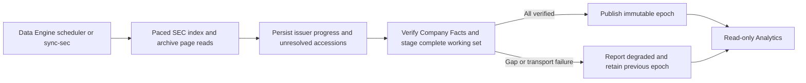

# V7 Stage 1 data reliability

The [V6 assessment and holdout](financial_repair_v6.md) are the baseline.
The Stage 1 implementation changes the SEC acquisition, share evidence, and
trailing-income inputs. Production scoring remains `hierarchical-equity-assessment-v2.1`
at 60/25/15. The additive `published-financial-inputs-v7.1` identifier records
the input methodology used by the API and coverage report. New valid
observations can change cross-sectional scores even when the formula is constant.

## SEC synchronization

The old health record reported four missing statements under the price job.
The combined refresh calls SEC verification before pricing and publication.
The existing Company Facts transport accepted the Submissions index as
discovery, retried all HTTP errors, and dropped unchecked accessions after the
rolling date window elapsed. It also exempted every amendment whose accession
was missing from Company Facts.

| Issuer | SEC accession missing from cached Company Facts |
|---|---|
| Dominion Energy | `0001193125-26-440697` |
| Citigroup | `0000831001-26-000056` |
| Prologis | `0001193125-26-436160` |
| Duke Energy | `0001326160-26-000051` |

All four filings appeared in SEC Submissions as Inline XBRL 10-Qs. A single
identified live Company Facts request for Citigroup returned HTTP 200 and its
issuer identity, but the payload still lacked the relevant accession. This
demonstrates a source-level gap for the tested issuer. Its cause and recovery
time are unknown. The test did not re-fetch the other three issuers.
[SEC API scope](https://www.sec.gov/search-filings/edgar-application-programming-interfaces)
· [SEC fair access policy](https://www.sec.gov/search-filings/edgar-search-assistance/accessing-edgar-data)



- Network failures, timeouts, 408, 429 and 5xx have bounded exponential
  retries. `Retry-After` is honored in the client or carried to the queue.
  The client stops the active batch after an access denial or an extended
  cooldown. Permanent errors terminate the current queue job rather than
  immediately retrying. The local configuration continues to enforce SEC
  identification, pacing and connection/read timeouts.
- Valid issuer responses replace the cache atomically and are checkpointed
  individually. Invalid issuer identities, malformed filing columns, and
  missing archive pages are reported per issuer. Duplicate Company Facts
  bytes reuse their stored digest.
- The persisted list retains unresolved accessions after the discovery
  window. The checkpoint survives an interrupted staging operation. An
  amendment is exempt only when its Submissions entry explicitly identifies
  it as non-XBRL. A recently completed issuer can be resumed from its cache.
- Preparation and manual publication check the persisted synchronization
  state. The last validated snapshot remains readable in degraded mode.
  Data Center presents the last verified synchronization, stale status,
  pending accessions, and issuer errors. Job publication and the raw
  financial writer remain under the existing Data Engine lock.

The four local gaps were recorded with the new checkpoint format. The
published manifest remained byte-for-byte unchanged. The new implementation
was verified with offline transport and recovery tests. A complete online
refresh remains unverified while the upstream requirement is unresolved.

## Share counts and market value

For an issuer whose catalogue supplies one supported listing, SEC DEI cover
shares are preferred. If the count is absent or stale, an issuer-wide
U.S. GAAP common share count may substitute only when its period and filing
date match a public periodic filing, the same vintage has one positive
value, and the count is fresh. USD quote age and split-basis checks still
apply. The newly supported BlackRock filing reported 154,606,029 common
shares on 2026-09-30 in accession `0001193125-26-447043`.

Multi-class totals use one reconciled Inline XBRL fiscal-instant set.
The Data Engine obtains the document at the SEC accession URL, verifies
its issuer, period, standard share unit and aggregate, and stages the
standalone `share_class_fact` Parquet dataset. The original response hash,
accession, share period, source URL, filing date, and common class dimension
are retained. A listed symbol is bound by matching the reported XBRL
member or an exact common/capital-stock listing title for that standard
class. Preferred security and debt listing titles are outside this mapping.
Analytics permits exact issuer value only when every positive class has
its own unique USD quote on the same observation date and the same checks
for the split basis pass. Older warehouse manifests remain valid.

| Alphabet class | Reported fiscal-date shares | Verification against 2026-11-20 prices |
|---|---:|---|
| Class A / GOOGL | 5.888 billion | Quote and split basis available |
| Class B | 0.828 billion | No verified listed price |
| Class C / GOOG | 5.578 billion | Identified in SEC listing; no compatible quote in the published panel |
| Total | 12.294 billion | Exact issuer market value remains unavailable |

The source is Alphabet's 2026-09-30 10-Q, filed 2026-10-29. Its cover page also
reports a separate October share date. The calculation uses the internally
reconciled fiscal-date set. Class B's conversion rights represent an economic
feature, while the issuer-level method requires an observed class value. The
staged inspection leaves both unsupported inputs explicit and calculates no
P/E from a quoted subtotal. Live Company Research continues to use the
existing published epoch until the SEC guard permits publication.
[Alphabet SEC filing](https://www.sec.gov/Archives/edgar/data/1652044/000165204426000084/goog-20260930.htm)
· [Alphabet capital stock terms](https://www.sec.gov/Archives/edgar/data/1652044/000165204423000016/googexhibit420q42022.htm)

## Trailing and fiscal-period policy

Trailing net income can use four contiguous supported quarters, or the
latest aligned fiscal-year bridge. The bridge adds the latest current YTD
income to the prior full-year income and subtracts the prior comparative
YTD. Accompanying requirements include the same YTD accession and filing
date, the same source concept, correctly adjacent fiscal starts, comparable
durations, and no later annual revision mixed into an earlier YTD filing.
If both methods end on the same date, reported quarters take precedence.
Quant mode exposes the bridge inputs and their signs. The production
valuation slot still uses fiscal-year earnings yield.

Interest coverage remains a midrank, bounded evidence slot. Extremely high
raw values, including Alphabet's 175.32×, cannot add more than the
slot's fixed contribution. EV, ROIC, and leverage retain the original
component requirements, so partial claims and unverifiable debt inputs
remain unavailable.

## Same-epoch coverage results

Both measurements use the existing immutable epoch
`20261122T201208616894Z-e607557332cc46c58caf3c62c4501d23`. The configured cohort,
cutoff, and eligibility definition were held fixed. At 2026-11-20, the
eligible count is 99:

| Available measure | V6 | V7 |
|---|---:|---:|
| Verified issuer market capitalization | 83 | 84 |
| Fiscal-year P/E | 80 | 81 |
| Trailing P/E | 5 | 68 |
| Fundamental Score | 79 | 80 |
| Risk Resilience Score | 77 | 77 |
| Opportunity Score | 61 | 62 |

The fallback restored BlackRock's **$170.33 billion** reported-share
capitalization, **30.67×** fiscal-year P/E, **24.64×** trailing P/E and
**59.81** Opportunity Score. No new financial observations were published.
The year-end comparison covers 2020–2025. For example, trailing P/E coverage
rose from 5 to 73 at 2022-12-31 and from 6 to 73 at 2025-12-31.

## API and product changes

- `GET /api/data/status` adds durable SEC state and freshness.
- `GET /api/warehouse/financial-coverage?as_of=YYYY-MM-DD` returns source,
  metric and score coverage, affected security IDs, and reasons. Annual
  statement, fresh shares, and capitalization diagnostics remain distinct.
  Existing reason codes are preserved in their original endpoints, with
  more specific coverage categories such as `MULTI_CLASS_SECURITY`.
- Company Research exposes share evidence when it is available in the
  published snapshot and shows trailing calculation provenance in Quant mode.
  Data Center displays missing issuer details and financial coverage.
- No database migration was needed. The optional Parquet evidence table and
  atomic operations checkpoint are separate from the DuckDB schema.

## Reproduce locally

```sh
make start
env PYTHONPATH=src .venv/bin/python -m finlab.engine.cli audit-sec
env PYTHONPATH=src .venv/bin/python -m finlab.analytics.cli coverage \
  2020-01-01 2026-11-20 --epoch 20261122T201208616894Z-e607557332cc46c58caf3c62c4501d23
```

`sync-sec`, `audit-sec --record`, and `stage-share-classes ACCESSION`
are Data Engine commands for use when the daemon is stopped, since they
require the writer lock. Existing scheduled and UI refresh paths retain
their normal behavior. The local verification reports are under
`data/reports/v7`.

## Implementation scope

| Stage 1 milestone | Result |
|---|---|
| A. SEC synchronization | Retry, validation, resume, health, and non-publication were implemented. The four upstream accessions remain unresolved. |
| B. Financial completeness | Same-epoch coverage and affected-security diagnostics are implemented. Broader vendor and statement coverage remain open. |
| C. Share classes | Reconciled, dated class evidence and strict issuer capitalization are implemented and tested. Actual Alphabet evidence is staged and full issuer value remains unsupported. |
| D. Fundamental correctness | Fiscal share fallback and trailing-income reconstruction were implemented. Comprehensive issuer-specific concept and cash-flow expansion remain open. |

Advanced factor research, score promotion, portfolio-aware decision research,
sentiment and broader onboarding remain separate stages. V7 did not run a
new holdout or change the V6 predictive conclusion.

## Source map

- SEC: `ingest/sec.py`, `ingest/submissions.py`, `ingest/companyfacts.py`,
  `engine/financial_sync.py`, `engine/status.py`, `engine/prepare.py`,
  `engine/cli.py`, `daemon/main.py`, and `daemon/queue.py`.
- Coverage and valuation: `analytics/coverage.py`, `analytics/company.py`,
  `analytics/assessment.py`, `analytics/fundamentals.py`, and `api/app.py`.
- Class evidence: `ingest/share_classes.py`, `db/conn.py`,
  `engine/snapshot.py`, and `analytics/snapshot.py`.
- Product: `frontend/src/ResearchTools.tsx`, `frontend/src/App.tsx`,
  `frontend/src/CompanyAssessment.tsx`, and `frontend/e2e/finlab.spec.ts`.
- Regression fixtures: `tests/test_sec_client.py`, `tests/test_financial_sync.py`,
  `tests/test_share_classes.py`, and `tests/test_fundamental_factors.py`.

## Verification

- The starting checkout passed 298 Python tests and the frontend lint and
  build checks. The updated checkout passed 312 Python tests, Ruff lint and
  formatting, TypeScript, frontend lint, and the production build.
- All eight Playwright workflows passed. The Data Center workflow verified
  the SEC status, the published financial coverage table, and the
  affected-security filter. A separate rerun verified both screenshot views.
- Offline transport fixtures exercise timeout and 429 recovery, bounded 503
  handling, 403 termination, malformed identities, duplicate content, and
  archive-page checkpoint recovery. Staging fixtures cover interrupted
  publication, amendments and older pending accessions.
- The class fixture verifies separate quoted classes, a split, a missing
  quote, and filing cutoff enforcement in a temporary immutable publication.
  The real Alphabet filing was staged using the existing writer lock and
  evaluated against pinned prices in a read-only inspection.
- Offline API checks blocked outbound sockets while reading the SEC health
  record and assessing BlackRock, Alphabet, and AAPL. AAPL at 2020-12-31
  reproduced its 70.57 Opportunity Score.
