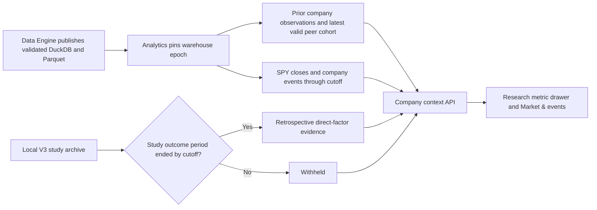

# V5 financial context

The first V5 increment adds company history, current peer comparisons, a
benchmark regime, and recorded events to Company Research. The descriptive
Opportunity Score retains the [V2 formulas and version](scoring_v2.md),
including the configurable 60% fundamental, 25% technical and 15% resilience
defaults. [The V5 tracker](implementation_plan.md#v5-quantitative-evidence-and-financial-context)
records which research and data extensions are still open.

## Sources and architecture



The existing `GET /api/analytics/factors/{identity}?as_of=YYYY-MM-DD` response
includes an additive `financial_context` field, version
`financial-context-v5.1`. The API uses the same validated, pinned warehouse
epoch as the assessment. The retrospective evidence reads the local V3 report.
The Data Engine owns provider I/O and financial data publication.

## Methodology

- **Company history.** Sample up to 20 cutoffs, each spaced 91 calendar days
  apart, strictly before the assessment. Recompute fiscal-year and supported TTM
  ratios with the inputs available at each sample cutoff. Range and observation
  count reflect available samples. Median and midrank percentile require eight
  comparable samples and a valid current observation. The Quant data includes
  population dispersion of sampled levels with eight observations, the change
  from the last valid sample, and the difference between the medians of the
  four newest and four preceding valid samples. These summaries describe the
  sample and do not identify structural breaks or estimate return volatility.
- **Peer context.** For the latest date in the publication, use current
  industry classifications first, then sector, within the same financial or
  nonfinancial issuer classification used by V2. Require eight distinct other
  eligible issuers with valid values for that particular metric. Exclude the
  subject's other share classes. If a peer issuer has multiple eligible share
  classes, use the first available value by stable security ID. Median and
  percentile exclude the subject. The percentile is the percentage of peer
  observations below the subject plus half the percentage tied. Ratios retain
  the existing applicability rules. Historical peer context requires dated
  classifications and is unavailable with the current warehouse.
- **Market regime.** Require the latest 253 completed US exchange sessions
  through the research cutoff with consistent Yahoo daily closes for SPY.
  SPY is in an uptrend when both its 252-session price return and distance from
  the 200-session mean are positive, and in a downtrend when both are negative.
  Other combinations are mixed. Use the sample standard deviation of the last
  60 daily price returns times √252 for annualized volatility. Distance from the
  252-session closing high is the latest close divided by that high minus one.
  These are price observations without dividend reinvestment.
- **Events.** The timeline includes SEC 10-K, 10-Q, 8-K and amendments, plus
  local corporate-action records. Accept verified SGML publication times
  before midnight New York following the research cutoff. A filing with
  unverified timing shows its filing date only. A corporate action shows its
  ex-date and source. The timeline provides filing identifiers and links where
  available and omits unverified guidance, surprises, and causal claims.
  Provider corrections can change the historical data in a later publication.
- **Predictive evidence.** The drawer can show the archived exact factor's
  21-session rank IC, interval, usable window count and Holm-adjusted p-value.
  It withholds the archive when its outcome period extends beyond the
  company cutoff. Where it appears, it describes retrospective outcomes
  across companies and is independent of the descriptive assessment. See
  [V3 methodology and results](validation_v3.md) for all four horizons,
  next-open execution, transaction costs, and study assumptions.

## Warehouse example

Epoch `20261122T143857959526Z-848451fc2e9a4d5caa6106a81a244a44`,
AAPL at 2020-12-31:

| Observation | Local result |
|---|---:|
| Fiscal-year P/E | 39.295× |
| Sampled historical P/E median | 16.63× |
| Historical P/E range | 9.84×–36.15× |
| Prior P/E samples | 20 |
| SPY 252-session price return | +15.09% |
| SPY 60-session annualized realized volatility | 15.86% |
| Company timeline | 20 events, including the 2020-10-30 SEC 10-K |

The assessment omits historical peers and withholds the V3 archive because the
study includes subsequent outcomes. The Opportunity Score is 70.57. At the
publication's latest price date, 2026-11-20, AAPL's fiscal-year P/E was 37.66×
versus a median of 26.05× among eight eligible Information Technology peers,
placing it at the 75th percentile in that cohort. That comparison uses the
publication's current classifications.

The V3 archive gives an Opportunity Score
mean rank IC of +0.024 at 21 sessions, with a 95% interval of −0.035 to +0.086
over 35 windows. Fundamental alone returned +0.031 on the same evaluation.
The archived universe is affected by survivorship bias and the V3 results
do not establish predictive superiority. This increment did not run a new
factor study or select new weights.

Release-vintage macro data, timestamped sentiment, dated peer membership,
broader historical technical distributions, and entry/exit validation remain
open. The company view marks macro and sentiment unavailable.

## Run locally

```sh
make start
curl 'http://127.0.0.1:8000/api/analytics/factors/AAPL?as_of=2020-12-31'
env FINLAB_E2E_URL=http://127.0.0.1:5173 npm --prefix frontend run test:e2e
```

Open [FinLab on the local frontend](http://127.0.0.1:5173).
