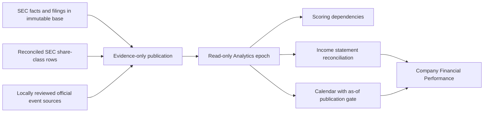
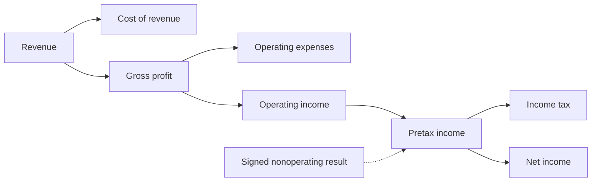

# FinLab V7 financial performance and data reliability

## Opportunity Score coverage

The November 20, 2026 assessment covers the same 99 eligible securities in both runs. Coverage rose from 62 to 63. Same-accession consolidated equity less separately reported minority interest recovers UnitedHealth's parent equity, $94.110 billion = $100.090 billion − $5.980 billion. Its fiscal-year assets of $309.581 billion give a 30.40% equity/assets ratio. The calculation requires a matching accession, filing date and fiscal instant. It has no issuer-specific exception.

The earlier P/E improvement from 5 to 68 concerns the **displayed trailing P/E**. The production score's valuation group uses **fiscal-year earnings yield** and a valid comparison pool. The trailing result does not satisfy that group or make independent financial-risk, cash-flow, or quality inputs available. The earlier score coverage moved from 61 to 62. This continuation recovered another score through financial-risk evidence. The 60/25/15 scoring formula and mandatory inputs are unchanged. [Company-by-company score dependency report](score_blockers_v7.md)

| Root cause | Before | After |
|---|---:|---:|
| Source missing | 23 | 22 |
| Unsupported input scope | 14 | 14 |
| Stale input | 9 | 9 |
| Multiple economic classes or unresolved class identity | 6 | 6 |
| Insufficient peers | 3 | 3 |
| Invalid denominator | 3 | 3 |
| Incompatible periods | 1 | 1 |

Causes can overlap. Before the changes, financial risk was the sole blocking slot for 18 issuers, fiscal-year valuation for 14 and free-cash-flow margin for one. Four others require several groups. The figures identify where to prioritize verification. They are upper bounds on score recovery from each slot.

Alphabet's 10-Q identifies 5.888 billion Class A, 0.828 billion Class B and 5.578 billion Class C shares at September 30, 2026. The published Class A close is $265.29. No compatible Class C quote was present and unlisted Class B has no verified market observation. The API exposes this evidence without estimating issuer capitalization. [Alphabet September 2026 10-Q](https://www.sec.gov/Archives/edgar/data/1652044/000165204426000084/goog-20260930.htm)

## SEC recovery and immutable publication

| Issuer | Form and quarter | Filed | Pending accession |
|---|---|---|---|
| D | Inline XBRL 10-Q, 2026-09-30 | 2026-10-30 | `0001193125-26-440697` |
| C | Inline XBRL 10-Q, 2026-09-30 | 2026-11-05 | `0000831001-26-000056` |
| PLD | Inline XBRL 10-Q, 2026-09-30 | 2026-10-28 | `0001193125-26-436160` |
| DUK | Inline XBRL 10-Q, 2026-09-30 | 2026-11-05 | `0001326160-26-000051` |

The cached Submissions index confirms these filings. The Company Facts cache contains no usable observation for these accessions. The prior live Citigroup check returned HTTP 200 with the requested issuer but without the accession. The latest diagnosis used the local cache for all four. A missing, unreadable, or wrong-issuer cache now keeps the relevant issuer pending with a distinct retryable diagnosis. Normal publication remains blocked until all pending filings are resolved. [SEC reliability and previous live check](data_reliability_v7.md#sec-synchronization)

The evidence-only epoch is `20261122T212044395384Z-eb313e5c99324bc691c7025620a6a92b`. Its parent is `20261122T201208616894Z-e607557332cc46c58caf3c62c4501d23`. Every core dataset checksum is unchanged. The Data Engine stages and publishes evidence under the existing writer lock, verifies that each share-class row references a filing in the parent and that each event references a published issuer, then advances the pointer atomically. Data Center identifies the publication scope and shows the open SEC checkpoint separately.



## Statement construction and reconciliation

Analytics selects a single accession and fiscal duration from the latest eligible original or amended filing for that period. USD observations must share issuer, fiscal dates and filing date. The reader admits a verified SEC acceptance timestamp only before the end of the selected New York date. Eligible date-only filings retain that precision. Annual and standalone quarterly values are never mixed with year-to-date observations. Up to eight annual and sixteen standalone quarterly statements are returned. Standalone Q4 requires a published quarterly observation.



When explicitly reported gross profit is unavailable, revenue less cost of revenue can supply it. Reported total costs less cost of revenue can supply aggregate operating costs, or gross profit less operating income can identify the aggregate as a residual. Operating expense components are displayed as Sankey branches only if disjoint reported concepts sum to the full aggregate. Pretax income less operating income can supply a signed nonoperating aggregate. The final bridge checks reported net income against pretax income less tax, using the consolidated profit concept when present. Reported-versus-calculated differences must be within one USD. Incomplete, mismatched, and core-loss statements retain their signed values and suppress the positive-flow chart. Segments are unavailable until dimensional revenue can be reconciled with eliminations and traced to the filing.

| Alphabet (USD billions) | Q3 2026 | Q3 2025 | FY 2025 |
|---|---:|---:|---:|
| Revenue | 127.577 | 102.346 | 402.836 |
| Cost of revenue | 51.419 | 41.369 | 162.535 |
| Gross profit, derived | 76.158 | 60.977 | 240.301 |
| Operating expenses | 35.582 | 29.749 | 111.262 |
| Operating income | 40.576 | 31.228 | 129.039 |
| Nonoperating income or expense, net | −8.221 | 12.759 | 29.787 |
| Pretax income | 32.355 | 43.987 | 158.826 |
| Tax expense | 5.887 | 9.008 | 26.656 |
| Net income | 26.468 | 34.979 | 132.170 |

Each reported bridge reconciled with zero difference. Operating margin rose from 30.5% to 31.8% year over year. The nonoperating aggregate moved from a gain to an expense, a $20.980 billion swing. The UI explains arithmetic effects and links company evidence for further interpretation. [Alphabet 2026 Q3 10-Q](https://www.sec.gov/Archives/edgar/data/1652044/000165204426000084/goog-20260930.htm) · [Alphabet 2025 10-K](https://www.sec.gov/Archives/edgar/data/1652044/000165204426000018/goog-20251231.htm)

## Official events and user interface

Company Research opens Financial Performance directly below price history. Readers can choose annual or quarterly periods, compare against the equivalent prior-year period, inspect Sankey flows by mouse or keyboard, and open Quant mode for filing concepts, source precision and checks. The signed table remains accessible on mobile and in print.

The calendar uses a reviewable local import alongside published SEC filing and corporate-action observations. It supports earnings announcements, confirmed calls, investor events, dividends and corporate actions. Future dates require an attributed source; date-only entries retain their precision. A completed earnings event links to its corresponding quarterly statement only once the filing is visible at the requested cutoff. On October 28 the Alphabet event is visible and the October 29 filing is still unavailable. The December 14 common-dividend payment is listed as confirmed as of November 20. [Calendar source records](alphabet_events_v7.json) · [SEC earnings exhibit](https://www.sec.gov/Archives/edgar/data/1652044/000165204426000080/googexhibit991q32026.htm)

## Reproduce locally

```sh
make start
env PYTHONPATH=src .venv/bin/python -m finlab.engine.cli audit-sec
env PYTHONPATH=src .venv/bin/python -m finlab.analytics.cli score-blockers 2026-11-20 --epoch 20261122T201208616894Z-e607557332cc46c58caf3c62c4501d23
env PYTHONPATH=src .venv/bin/python -m finlab.analytics.cli score-blockers 2026-11-20 --epoch 20261122T212044395384Z-eb313e5c99324bc691c7025620a6a92b
curl 'http://127.0.0.1:8000/api/analytics/financial-performance/GOOGL?as_of=2026-11-20'
```

To install the reviewed calendar on a compatible warehouse, stop the Data Engine writer, run `env PYTHONPATH=src .venv/bin/python -m finlab.engine.cli stage-events docs/alphabet_events_v7.json`, then run `env PYTHONPATH=src .venv/bin/python -m finlab.engine.cli publish-evidence` and restart the daemon. No database migration was required. The local reports and screenshots are under `data/reports/v7-performance/`.

The independent calendar feed is seeded for Alphabet. Other issuers still get their published SEC filings and price-provider corporate actions. Prospective events for additional issuers require reviewed sources. The full SEC publication remains degraded and no complete multiclass Alphabet valuation or segment waterfall is available.
