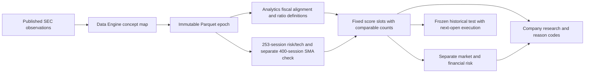

# V6 financial data repair and research evidence

V6 starts from the Alphabet assessment at 2026-11-20. The Data Engine published
the repaired concept map through the existing writer lock. Analytics reads
either immutable epoch and exposes the new evidence and reason codes while
preserving the 60/25/15 opportunity weights.

| Input | Pinned epoch |
|---|---|
| Initial Alphabet and coverage baseline | `20261122T143857959526Z-848451fc2e9a4d5caa6106a81a244a44` |
| Repaired concept map and validation input | `20261122T201208616894Z-e607557332cc46c58caf3c62c4501d23` |



## Alphabet root causes

| Metric or group | Source, calculation and resolution |
|---|---|
| Fiscal-year P/E, TTM P/E, earnings yield, FCF yield and market-cap-based multiples | The SEC archive contains aggregate common shares. The security catalogue has multiple symbols for this issuer, including market listings and catalogue aliases. The warehouse has no filing-backed mapping of shares to economic classes and corresponding class prices or a defensible valuation for unlisted shares. The normalized filing facts can support net income, but they cannot establish aggregate market value. The ratios report `UNSUPPORTED` where valuation is the blocker. The sampled historical P/E percentile is also unavailable. |
| Verified total debt, debt/equity, cash/debt and net debt/EBITDA | There is no verified combined short- and long-term debt tag for the aligned fiscal year. The normalized candidate is long-term debt only. The company reports term debt and commercial paper, which support a separate 8.15% reported-category debt/assets measure. That measure had six scoreable observations in its normalization cohort, below the required eight. The service reports `UNSUPPORTED` for the full-debt definitions and `INSUFFICIENT_PEERS` for the score slot alternative. |
| Nonoperating interest coverage | FY2025 SEC accession `0001652044-26-000018` reports USD 736 million as gross nonoperating interest expense. The tag was present in the original fact warehouse and absent from its concept map. With the V6 map, USD 129.039 billion in aligned operating income divided by USD 736 million yields **175.32×**. This uses its own concept, ratio and normalization sample of 39 observations, without substituting for total interest expense or summing overlapping categories. The separate current ratio supplies liquidity evidence with 77 observations. [FASB taxonomy update](https://storage.fasb.org/2024%20GAAP%20and%20SEC%20Reporting%20Taxonomy%20Improvements%20and%20SEC%20Update%20%28Slide%20Presentation%29.pdf) |
| Enterprise value, EV/EBITDA and ROIC | The existing full definitions require documented claims and aligned balance-sheet components. For Alphabet, verified total debt is missing and market-value ratios also lack verified class-based capitalization. Depreciation availability alone cannot recover them. Missing claims and debt components retain their individual diagnostics. |
| SMA200 slope | The indicator divided the latest 200-session mean by the preceding nonoverlapping 200-session mean, then subtracted one. Analytics only read 253 observations. It now loads a separate 400-session window and requires a contiguous and consistent Yahoo price basis for this measure. The slope is **+41.50%**. The current price remains **21.27% below** SMA200. Those observations describe different windows. Existing technical and volatility calculations still use the original 253-session input. |
| No positive contributions | The previous headline showed contributions only from complete scoring dimensions. Company Research now distinguishes supported group evidence from contributions to a complete Opportunity Score. |

The public Company Facts API focuses on standard taxonomy and issuer-wide
observations. A general repair for class-level capitalization or issuer-specific
disclosures requires validated dated Inline XBRL contexts and security-class
mapping in the Data Engine. [SEC EDGAR API scope](https://www.sec.gov/search-filings/edgar-application-programming-interfaces)

## Scoring and coverage results

`hierarchical-equity-assessment-v2.1` adds the nonoperating-interest coverage
alternative after the existing financing alternatives. The fixed financing
slot and liquidity slot retain equal shares of the Financial Risk Score.
Market Risk continues to require volatility and maximum drawdown with eight
comparable observations per slot. Higher scores mean greater relative
resilience. Composite risk requires both groups and gives each half its
weight. No coverage threshold or opportunity weight changed.

| Alphabet, 2026-11-20 | Before | After |
|---|---:|---:|
| Observed close | $265.29 | $265.29 |
| Technical Score | 19.6 | 19.6 |
| Market Risk group | 38.6, breakdown only | 38.6, separately displayed |
| Financial Risk | Unavailable | 88.7 |
| Composite Risk Resilience | Unavailable | 63.6 |
| Fundamental | Unavailable, three of four groups | Unavailable, three of four groups |
| Opportunity Score | Unavailable | Unavailable |

The earlier PDF's 75% risk figure averaged completed slots, while the API's
50% counted completed groups. Both were consistent with one full and one
half-complete group. The repaired case has full coverage on both measures.
AAPL at 2020-12-31 retains **70.57** overall, **65.63** fundamental and **60.31**
risk resilience.

Additional offline API regressions cover loss-making Intel with an
`INVALID_DENOMINATOR` P/E, Oracle with verified debt/assets of **49.49%**,
BlackRock at 2020-12-31 with no aligned annual anchor, and JPMorgan with
industrial EV/EBITDA marked `NOT_APPLICABLE` and book equity/assets available.

| Available assessments or measures | Eligible | Before | After |
|---|---:|---:|---:|
| 2026-11-20 Fundamental Score | 99 | 79 | 79 |
| 2026-11-20 full Risk Resilience | 99 | 44 | 77 |
| 2026-11-20 Opportunity Score | 99 | 33 | 61 |
| 2026-11-20 SMA200 slope | 99 | 0 | 99 |
| 2026-11-20 nonoperating interest coverage | 99 | 0 | 39 |
| 2025-12-31 full Risk Resilience | 100 | 45 | 77 |
| 2025-12-31 Opportunity Score | 100 | 34 | 59 |

The report samples year-ends 2018–2025 and the final session cutoff, separately
for financial and nonfinancial issuers. The pre-repair baseline used the code
at `2be4feb`. The after report records missing-reason counts and distinguishes
structural unavailability at the cutoff from unresolved input and contract
gaps. These are point-in-time samples rather than daily average coverage.
The publication used existing working data without fetching providers. Since
the filing and fact checksums differ between the two epochs, an additional
control held the repaired epoch fixed and removed only the nonoperating
interest alternative. It reproduced the before counts of 44 Risk Resilience
and 33 Opportunity Scores at 2026-11-20, and 45 and 34 at 2025-12-31. This
isolates the addition's effect on score availability. A fallback unavailable
for its own comparison sample is excluded from recovered scores.

```sh
env PYTHONPATH=src .venv/bin/python -m finlab.analytics.cli coverage \
  2018-01-01 2026-11-20 --epoch 20261122T201208616894Z-e607557332cc46c58caf3c62c4501d23
```

Local outputs are `data/reports/v6/coverage-before.json` and
`data/reports/v6/coverage-after.json`.

## Historical test protocol

The [V3 research engine](validation_v3.md) provides next-open adjusted
execution, selection embargoes, separate cost-adjusted SPY and model paths,
nonoverlapping outcomes within each horizon, block-bootstrap uncertainty and
Holm adjustment. V6 adds a fixed test boundary, chronological factor-rank
stability and separate observations for three- and six-month momentum,
SMA200 slope, fiscal-year earnings growth and nonoperating interest coverage.
The V6 run fixes the factor directions and the pre-existing model candidates.
The adaptive selection uses only training and validation labels that matured
before the boundary with the configured embargo, then keeps the same
selection throughout testing. Horizons without mature training and validation
remain unselected. All static comparisons, including fundamental-only and SPY,
remain available where data supports them.

Both the entry and thesis-review rules estimate conditional outcomes separately
using the same held-out dates. A false alarm is a flagged position that
fails to beat SPY for entry research or fails to lag SPY for thesis review.
The report also records matched coverage, loss frequency, missed outcomes,
5th-percentile returns where supported and regime summaries. These are
conditional research checks with hypothetical round-trip costs, not simulations
of a position-aware exit portfolio or a measure of its turnover. Historical
membership, sector classifications and delisting settlement remain incomplete.
The experiment is retrospective, even though its training and test periods are
separated. An observed signal does not establish future performance.

```sh
env PYTHONPATH=src .venv/bin/python -m finlab.analytics.cli validate-signals \
  2020-01-02 2026-11-20 --test-start 2023-01-01 \
  --epoch 20261122T201208616894Z-e607557332cc46c58caf3c62c4501d23
```

V6 archives a separate study and retains the V3 baseline. Model Validation
lets the reader choose the archive without running a simulation. Company
Research keeps its factual observations and exploratory decision checks separate
from model validation.

## Held-out results

Report `validation-v6-2020-01-02-2026-11-20-e12636e4497b72ca.json` records
the repaired epoch, source hash
`f7c6d6fa0ed195bbdbf68d4c91132421615c62684bfdf90822719f677dc25d16`,
costs of 10 basis points per side, factors, forward windows and frozen
selection decisions. The first held-out signal is 2023-01-03. The final
21-session window ended 2026-11-09. All windows are surviving-universe
studies. The frozen 21-session selection kept fundamental-only after its
pre-test validation, which ended 2022-12-01. At 63, 126 and 252 sessions,
the training and validation requirement prevented adaptive selection.

| Forward horizon | Test windows | Opportunity mean rank IC | 95% interval | Fundamental-only IC |
|---:|---:|---:|---|---:|
| 21 | 46 | +0.006 | −0.040 to +0.054 | +0.018 |
| 63 | 15 | +0.011 | −0.047 to +0.071 | +0.047 |
| 126 | 7 | +0.042 | Unavailable | −0.007 |
| 252 | 3 | −0.081 | Unavailable | −0.073 |

| 21-session model | Rank IC | Net daily-path Sharpe | Max drawdown |
|---|---:|---:|---:|
| Opportunity | +0.006 | 1.06 | −16.9% |
| Fundamental only | +0.018 | 1.14 | −14.6% |
| Technical only | +0.024 | 1.02 | −22.7% |
| Risk only | −0.076 | 0.40 | −15.3% |
| Fundamental + technical | +0.025 | 1.13 | −21.3% |
| Fundamental + risk | −0.045 | 0.74 | −22.5% |
| Legacy | −0.027 | 0.93 | −17.6% |
| Equal-weight common cohort | — | 1.19 | −15.4% |
| SPY with matched costs | — | 1.11 | −18.8% |

The 21-session Opportunity Score had an effective sample of 46 windows.
Its paired net return difference versus fundamentals alone was **−0.02
percentage points** per window, with a 95% interval of **−0.87 to +0.68**
percentage points. The study does not establish Opportunity Score superiority.
A few nominally strong results on small or correlated samples do not change
that conclusion.

At 21 sessions, P/E had rank IC +0.011, revenue growth +0.029, annual
earnings growth +0.009, SMA200 slope +0.017, and price/SMA200 −0.005.
All five intervals included zero. EV/EBITDA had 19 available
security-window observations out of 4,600 eligible observations, and ROIC
had 34, both below usable cross-sectional coverage. Lower realized
volatility had a negative association with subsequent returns in this
sample, IC −0.098 with a 95% interval of −0.158 to −0.048 and a
factor-family Holm-adjusted p-value of 0.045. This concerns rank
association in the evaluated universe and does not establish trading
profitability or justify giving volatility a new production weight.

| 21-session research condition | Flagged observations | Mean net gap vs unflagged | 95% interval | Mean false alarm share |
|---|---:|---:|---|---:|
| Entry | 373 | +0.03 pp | −0.86 to +0.89 pp | 51.4% |
| Thesis review | 824 | +0.41 pp | −0.45 to +1.52 pp | 49.7% |

Both conditional intervals cross zero. No entry or exit rule was promoted.

## Verification

- 298 Python tests passed. Ruff lint and formatting checks passed.
- TypeScript, frontend lint, and the Vite production build passed.
- Eight Playwright workflows passed against the local services. They include
  desktop and mobile Alphabet research, coverage reasons, the early chart,
  independent V6 validation, and the skippable Company Research guide.
- Offline API checks denied socket connections while evaluating six
  representative company and cutoff pairs from the published warehouse.
- The final two-page A4 PDF was rendered and inspected on both pages. Navigation
  and search are absent, the score text is legible, and the price chart
  includes the final observation and price axis.

## Source map and remaining work

- Data Engine normalization and publication use `src/finlab/data/concept_map.yaml`
  and the existing offline `finlab.engine.cli prepare` command.
- Financial calculations and availability are in `analytics/company.py`,
  `fundamentals.py`, `factors.py` and `assessment.py`. Historical raw and score
  coverage is in `analytics/coverage.py` and `analytics/cli.py`.
- Holdout testing uses `research/validation_v3.py` and
  `research/decision_evidence.py`. Read-side support is in
  `analytics/validation_view.py` and `api/research.py`.
- Frontend changes are in `App.tsx`, `App.css`, `CompanyAssessment.tsx`,
  `FinancialChart.tsx`, `ModelValidation.tsx`, `ResearchGlossary.tsx`, `financialGlossary.ts`
  and `format.ts`. `frontend/e2e/googl-research.spec.ts` covers the Alphabet
  workflow and exported report.

Outstanding work includes authoritative economic-class mappings, broader SEC
footnote and issuer-specific extraction, historically valid industry peers,
macro-release vintages, calibrated sentiment, application-wide onboarding, and
position-aware exit validation. Current peer comparisons and historical
company context retain the [V5 methodology](financial_context_v5.md).
The Data Engine still reports a pre-existing synchronization failure for
pending SEC Company Facts. The offline publication repaired the concept map
independently of the upstream synchronization job.
