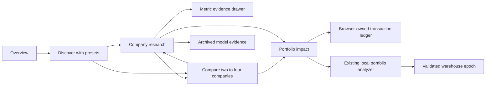

# FinLab V4 product and implementation guide

V4 improves the path from discovery to portfolio evaluation. The Data Engine
still owns all external ingestion and the financial database. The browser keeps
comparison selections, watchlists and portfolio transaction records separately
from the financial warehouse. V4 reads Scoring V2's evidence and the V3 research
archive without changing their calculations.

[UX audit and visual baseline](ux_v4_audit.md) · [Architecture](architecture.md) ·
[Scoring V2](scoring_v2.md) · [Archived V3 results](validation_v3.md)

## Company research and charts

A company hypothesis now has a price and observation date, a relative score and
coverage, quick reads on valuation, trend and risk, and the leading supported
signals. Company research categories switch between valuation, business quality,
technicals, risks and the score breakdown. Each metric button opens a single
native dialog. Escape closes it and restores keyboard focus. Simple view explains
the observation, while Quant view adds the formula, applicable filing inputs,
normalization, relative score contributions and model version.

The historical series uses published observations. Fiscal-year charts display
filed revenue and income. Historical free cash flow requires compatible operating
cash flow and capex from matching periods. Valuation histories appear when the
assessor returns comparable sampling dates. There is no fabricated operating
history or historical series of score dimensions, and current sector classifications
are not treated as historical peer evidence.

Lightweight Charts provides axes, hover crosshair, zoom, resizing and overlays.
One lazy-loaded chart component also serves archived returns, benchmark and
portfolio views. The keyboard session slider, observed-value readout, and
descriptive chart names remain accessible without pointer interaction.
Daily company charts use close-price returns, which exclude reinvested dividends.
Validation curves use the adjusted net returns in the archive. Stock
benchmark lines are rebased on the first shared observation. Missing overlay
observations are represented as gaps, and incomplete archival paths suppress
continuous capital curves.

ECharts was considered for its broader analytical and built-in ARIA capabilities.
The project chose a single financial chart library and uses semantic HTML for
the IC histogram and the score buckets. [Lightweight Charts documentation](https://tradingview.github.io/lightweight-charts/docs) ·
[ECharts accessibility handbook](https://echarts.apache.org/handbook/en/best-practices/aria/)

Lightweight Charts™ is provided by TradingView under the Apache License, Version
2.0. Copyright 2023 TradingView, Inc. The chart includes TradingView attribution.
[TradingView](https://www.tradingview.com/) · [License](https://github.com/tradingview/lightweight-charts/blob/master/LICENSE)

## Discovery and comparison

Presets describe a point-in-time cohort. They do not select strategies, infer
intrinsic value, or use subsequent outcomes.

| Preset | Rule |
| --- | --- |
| Strong fundamentals | Fundamental score at least 65. |
| Attractive valuation | Positive earnings yield at or above the cohort's empirical 75th percentile. |
| Positive momentum | Positive three-month price return and price above SMA200. |
| Potential value traps | Meets the valuation preset and has negative revenue growth or a fundamental score below 50. |
| Improving scores | Opportunity score rose by at least five points from the prior-week cutoff with the same epoch, model and membership policy. |
| Lower market risk | Annualized volatility at or below the cohort's empirical 25th percentile. |

The quartile rules require at least eight finite observations. Missing values
cannot pass a numerical filter. Industry and market-value filters only use
published fields. Industry metadata may be current even for a historical cutoff.
Comparison reads a single discovery response at the selected date, so its
columns share an epoch. Values can still have different observation dates or
be economically incomparable, and the app does not assign a universal winner.

## Portfolio

The editor supports buy and sell transactions, edits, confirmed removal, and
advanced CSV import/export. A guided trade resolves company identity from the
local publication and saves the stable ID internally. Portfolio trades use
one base currency per ledger. Foreign-currency positions require explicit
transaction and valuation FX where appropriate. A pending ledger containing
sales is checked by the existing split-aware FIFO analyzer before saving.
Malformed ledger data and conflicting tab updates prevent silent overwrites.
The legacy CSV calculator remains available inside the advanced section.

The holdings view exposes market value, open-position cost basis, realized and
unrealized P/L, allocation, exposure and concentration. The scenario form
compares holdings before and after a hypothetical addition. Holdings history
presents up to six completed month-end observations for single-currency records.
This series incorporates contributions and withdrawals and should be read as
holdings value. Mixed-currency holdings do not get historical curves unless
a supported historical FX source is implemented. CSV exports are the portable
backup for this browser-local store.

## Model evidence policy

The archive supplies the conclusions through a tested projection. For each
horizon and ranked strategy, FinLab requires at least 12 usable windows, an
effective sample of eight, and a dependence-aware 95% rank-IC interval.
Otherwise the displayed state is **Insufficient evidence**. When those
requirements are met, directional evidence also requires the interval to
exclude zero and the Holm-adjusted p-value to be below 0.05. The adjustment
uses the full model and horizon family, including planned cells with missing
p-values. Fixed-model results use historical terminology. The adaptive
walk-forward strategy can receive the out-of-sample label. Other supported
results are **Predictive evidence inconclusive**.

The archived Opportunity Score remains inconclusive over 35 one-month windows.
The twelve-month view now correctly displays insufficient evidence. This policy
changes how evidence is interpreted and presented. The archived ranks, windows,
fees, effective samples, and results are preserved. The series endpoint projects
one archive model at a time. It compounds daily values against its matching SPY
returns only when all included trading sessions and windows reconcile.

## Data Center

The operations area contrasts the most recent completed expected session with
the latest published close. A provider label identifies the source of published
prices and does not represent a live connectivity test. Refresh runs through the
existing Data Engine request inbox. The status writer retains the most recent
50 completed attempts in its separate control snapshot, including detail and
completion time. History begins with updated engine runs. Earlier periods fall
back to the known publication time. Full process logs remain on disk and
historical backfill uses the existing CLI.

## Source changes and verification

| Source | Purpose |
| --- | --- |
| `frontend/src/App.tsx`, `App.css` | Journey, responsive shell, evidence summary, comparison storage, data status and design surfaces. |
| `frontend/src/CompanyAssessment.tsx`, `Compare.tsx`, `MarketViews.tsx` | Company evidence, comparison, discovery presets and advanced filters. |
| `frontend/src/FinancialChart.tsx`, `DeferredChart.tsx` | Financial chart integration and lazy loading. |
| `frontend/src/Portfolio.tsx`, `portfolioLedger.ts`, `ResearchTools.tsx` | Guided ledger and valuation, optional CSV tooling, strategies and operational history. |
| `frontend/src/ModelValidation.tsx` | Evidence policy results, archived plots, model and factor comparisons. |
| `src/finlab/analytics/discovery.py`, `validation_view.py` | Comparable display fields and archive evidence projection. |
| `src/finlab/api/app.py`, `api/research.py`, `engine/status.py` | Backward-compatible local display and job status additions. |
| `frontend/e2e/finlab.spec.ts`, `playwright.config.ts`, `tests/test_validation_view.py`, `tests/test_engine_status_history.py` | Browser coverage, statistical policy checks, archive projection and bounded operational history tests. |

The browser baseline and final captures are under `data/reports/ui-v4/`. See
[frontend instructions](../frontend/README.md) for launch and verification.
