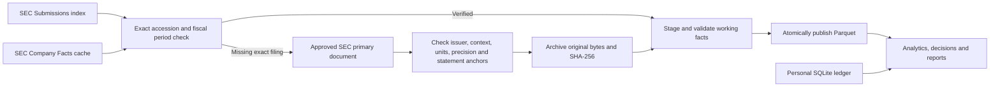

# FinLab V8 implementation and verification

## Baseline

The starting checkout passed 327 Python tests, Ruff lint and format, frontend lint, TypeScript, and the production build. The published universe included 99 eligible issuers and 63 Opportunity Scores on 2026-11-20. Four Inline XBRL 10-Qs remained in the SEC checkpoint. Browser localStorage owned the transaction ledger. Model evidence was already computed from archived statistics, but the UI exposed V3 and V6 only. Current company research already offered contextual glossary, simple entry and deterioration checks, and the completed financial flow chart.

## Financial data recovery

The SEC Company Facts endpoint returned a valid Citigroup issuer payload without accession `0000831001-26-000056`. The primary filing was available. On verified Company Facts gaps, the Data Engine now requests the exact Inline XBRL primary document from the SEC Submissions index. Provider access restrictions still govern the request path. The fallback does not run after authentication, access, or rate-limit errors from Company Facts. [SEC data scope](https://www.sec.gov/search-filings/edgar-application-programming-interfaces) · [SEC fair access](https://www.sec.gov/search-filings/edgar-search-assistance/accessing-edgar-data)

The parser validates issuer, form, amendment status, reporting period, taxonomy, denomination, fiscal window, and anchor observations from the balance sheet, income statement, and cash flow statement. Consolidated USD, shares, and USD/share observations with supported precision and transformation rules can be loaded. Same-key values at different disclosed precisions must agree within rounding tolerance. Inconsistent observations are excluded and missing anchors block recovery. The loader stores the original SEC bytes, hashes, and source metadata separately, re-verifies them when replayed, and prefers an exact Company Facts match if it later appears. The previous publication remains usable if staging fails.



The live run completed with zero pending statements and zero issuer errors. It verified 976 normalized observations across four primary filings and published epoch `20261123T033142680268Z-19d2986d52514fb9a616c3bfa6454fe8`.

| Company | Recovered observations | Primary filing |
| --- | ---: | --- |
| C | 345 | [2026 Q3 10-Q](https://www.sec.gov/Archives/edgar/data/831001/000083100126000056/c-20260930.htm) |
| D | 250 | [2026 Q3 10-Q](https://www.sec.gov/Archives/edgar/data/715957/000119312526440697/d-20260930.htm) |
| PLD | 148 | [2026 Q3 10-Q](https://www.sec.gov/Archives/edgar/data/1045609/000119312526436160/pld-20260930.htm) |
| DUK | 233 | [2026 Q3 10-Q](https://www.sec.gov/Archives/edgar/data/1326160/000132616026000051/duk-20260930.htm) |

On identical company-date membership, Dominion Energy and Prologis gained Opportunity Scores.

| Measure | Prior epoch | Recovered epoch |
| --- | ---: | ---: |
| Opportunity Score | 63 / 99 | 65 / 99 |
| Fundamental Score | 80 / 99 | 82 / 99 |
| Reported shares | 87 / 99 | 90 / 99 |
| Issuer market capitalization | 84 / 99 | 86 / 99 |
| Fiscal-year P/E | 81 / 99 | 83 / 99 |
| FCF yield | 69 / 99 | 70 / 99 |

Issuer-by-issuer reasons are in `data/reports/v8/score-blockers-before.json` and `score-blockers-after.json`. Multi-class valuation still requires defensible class-specific prices and economic rights. Alphabet's full valuation remains unavailable. The eligible universe still contains 34 securities without a combined score.

## Held-out research

The trial registry stores model version, universe, pinned epoch, source archive, candidate weights, code hash, parameter selection, and results in the local research archive. V8 applies the existing chronological selection protocol with a held-out boundary on 2023-01-01, prior-calendar-day filing cutoffs, next-session execution, 10 basis points per side, and an embargo of one session. Forward windows are nonoverlapping within horizon. Block-bootstrap intervals address serial dependence, and Holm-adjusted tests cover factor and model comparisons. Stronger inference requires more data and reliable dated historical membership.

V8 evaluated 31 factors. The additional price-to-earnings historical percentile uses at least eight earlier sampled observations within five years. EBITDA growth requires an aligned operating-income and D&A pair for each year, within the same accession per pair. MACD is divided by the same-date close. The study includes value-only, quality-only, and growth-only ablations on the matched model membership. The production 60/25/15 score remains versioned separately from experimental configurations.

| Sessions | Held-out windows | Opportunity rank IC | 95% dependence-aware interval | Change on exact V7 company-date sample |
| ---: | ---: | ---: | --- | ---: |
| 21 | 46 | +0.0018 | −0.0429 to +0.0478 | 0 |
| 63 | 15 | +0.0049 | −0.0532 to +0.0664 | 0 |
| 126 | 7 | +0.0282 | Insufficient windows | 0 |
| 252 | 3 | −0.0885 | Insufficient windows | 0 |

The final 21-session decision was 2026-10-09. The recovered filings were published between 2026-10-28 and 2026-11-05, so they were unavailable on all held-out signal dates. The 21-session score-eligible membership and its tested returns were identical on the V7 and V8 epochs. The newly recovered November assessments therefore do not establish a change in predictive performance.

| 21-session comparison | Rank IC | Annualized return |
| --- | ---: | ---: |
| SPY | — | 17.0% |
| Equal-weight universe | — | 16.1% |
| Legacy | −0.0262 | 13.3% |
| Opportunity | +0.0018 | 18.9% |
| Fundamental only | +0.0158 | 19.0% |
| Technical only | +0.0195 | 20.4% |
| Resilience only | −0.0773 | 4.2% |
| Value only | +0.0212 | 26.0% |
| Business quality only | −0.0178 | 16.7% |
| Growth only | +0.0232 | 23.1% |
| Fundamental and technical | +0.0194 | 23.6% |
| Fundamental and risk | −0.0483 | 9.3% |
| Equal dimension weights | −0.0156 | 21.6% |

Value-only's matched per-window net excess advantage over fundamental-only averaged +0.47 percentage points, with a 95% interval of −0.30 to +1.21 percentage points and Holm p=1.00. Its sample point estimate does not establish superiority. The protocol selected fundamental-only as its 21-session comparison baseline before held-out testing. No alternative weights passed promotion criteria. Long horizons lacked sufficient windows for selection.

| 21-session factor example | Covered company-windows | Mean rank IC | 95% interval |
| --- | ---: | ---: | --- |
| Fiscal-year P/E, lower oriented | 3,779 / 4,600 | +0.0105 | −0.0401 to +0.0630 |
| TTM P/E, lower oriented | 2,912 / 4,600 | −0.0129 | −0.0636 to +0.0479 |
| Historical TTM P/E percentile, lower oriented | 2,893 / 4,600 | −0.0006 | −0.0471 to +0.0446 |
| ROE | 2,604 / 4,600 | −0.0323 | −0.0673 to +0.0008 |
| EBITDA growth | 2,100 / 4,600 | +0.0201 | −0.0367 to +0.0762 |
| Relative 12-month momentum | 4,600 / 4,600 | +0.0133 | −0.0511 to +0.0653 |
| Beta, lower oriented | 4,600 / 4,600 | −0.1120 | −0.1795 to −0.0539 |

Beta's Holm p-value was 0.122. No tested 21-session factor passed the family-wide 5% threshold. Reports preserve per-factor medians, coverage, quintiles, rank stability, regime effects, turnover, and costs in `data/reports/research/validation-v8-2020-01-02-2026-11-20-f4fe931735aab097.json`. Historical membership, sector histories, and delisting settlement data remain limited. The study has survivorship bias.

## Research, events, and portfolio

Company Research separates descriptive business quality, valuation, growth, cash-flow quality, market timing, and market and financial resilience. Decision Research displays observed entry and deterioration conditions, the input values, missing variables, and what changes the condition. A user selects 21, 63, or 252 sessions to see the corresponding held-out evidence. The holding review characterizes the tested deterioration condition. It cannot evaluate a user's full thesis or personal portfolio exposure.

The global Calendar provides month, week, and upcoming views, plus company, watchlist, and category filters. It reads published SEC filings, corporate actions, and reviewed official event records. Future dates require published evidence. Past scheduled events without independent confirmation retain an unverified occurrence state. Completed earnings events link to Financial Performance only after the matching statement is available at the selected cutoff. The existing Sankey is covered by the browser regression. The reviewed future event inventory is sparse.

The initial sentiment pipeline archives reviewed SEC earnings-release narratives. Analytics uses an explicit English lexicon with simple local negation handling, publishes document and text hashes, reports attention counts, and calculates balance changes only when both 30-day intervals have observed scores. The first verified corpus contains Alphabet's October 28 earnings release, producing positive lexical tone on three matches. This is descriptive language classification with sparse coverage. The workflow has no predictive validation or production score weight. Broad news collection and prospective event discovery remain open. [Alphabet earnings release](https://www.sec.gov/Archives/edgar/data/1652044/000165204426000080/googexhibit991q32026.htm)

Portfolio transactions now persist in `data/personal/portfolio.sqlite`. Atomic SQLite writes compare the expected revision with the current revision. Older revisions remain readable via the API. The browser migrates a valid browser ledger only when the local store has no revisions. Differing browser records remain available as a separate CSV export. A fresh browser can read the same local ledger, and valuation still uses the published warehouse.

The company guide is skippable and reopenable from Help. It leads from search through assessment, valuation, price history, statistical evidence, and saving to the watchlist.

## Reproduce locally

```sh
make start
env PYTHONPATH=src .venv/bin/python -m finlab.engine.cli audit-sec
env PYTHONPATH=src .venv/bin/python -m finlab.analytics.cli score-blockers 2026-11-20 --epoch 20261123T033142680268Z-19d2986d52514fb9a616c3bfa6454fe8
env PYTHONPATH=src .venv/bin/python -m finlab.analytics.cli validate-signals 2020-01-02 2026-11-20 \
  --test-start 2023-01-01 --epoch 20261123T033142680268Z-19d2986d52514fb9a616c3bfa6454fe8 \
  --baseline-report data/reports/research/validation-v7-2020-01-02-2026-11-20-3be3a2c09bf59790.json --expanded
.venv/bin/pytest -q
.venv/bin/ruff check .
.venv/bin/ruff format --check .
npm --prefix frontend run lint
npm --prefix frontend run build
env FINLAB_E2E_URL=http://127.0.0.1:5173 npm --prefix frontend run test:e2e
```

With the daemon stopped for the writer lock, `env PYTHONPATH=src .venv/bin/python -m finlab.engine.cli sync-sec` performs the normal SEC verification and full publication. To stage new reviewed releases, run `env PYTHONPATH=src .venv/bin/python -m finlab.engine.cli sync-financial-news`, then `env PYTHONPATH=src .venv/bin/python -m finlab.engine.cli publish-evidence`. The live news evidence epoch is `20261123T034331088143Z-9a33492f939f4db3b094e2b62295cce4`.

## Final verification

- 339 Python tests passed. Ruff lint and formatting, frontend lint, TypeScript, and the production build passed.
- 12 Playwright workflows passed, including calendar source attribution and watchlist filters, period links into the existing Sankey, archived V8 evidence, guided research, and restoration after browser storage reset. The browser ledger workflows use an isolated protocol fixture. Backend tests exercise the real SQLite ledger and its revision history in a temporary data directory.
- An offline smoke check disabled outbound sockets while reading the latest SEC checkpoint, counting all four accessions in published Parquet, reading the V8 study, and verifying Alphabet's calendar and Sankey.

### Source changes

| Area | Files |
| --- | --- |
| SEC and text ingestion | `src/finlab/engine/financial_sync.py`, `engine/cli.py`, `engine/snapshot.py`, `db/conn.py`, `ingest/companyfacts.py`, `ingest/statement_recovery.py`, `ingest/financial_text.py` |
| Research and API | `src/finlab/research/protocol_v8.py`, `research/validation_v3.py`, `analytics/cli.py`, `analytics/assessment.py`, `analytics/validation_view.py`, `analytics/financial_context.py`, `analytics/decision_context.py`, `analytics/event_calendar.py`, `analytics/sentiment.py`, `analytics/portfolio_ledger.py`, `api/app.py`, `api/research.py` |
| Product | `frontend/src/App.tsx`, `App.css`, `ResearchTools.tsx`, `ModelValidation.tsx`, `CompanyAssessment.tsx`, `DecisionResearch.tsx`, `EventCalendar.tsx`, `FinancialPerformance.tsx` (period deep-link only), `Portfolio.tsx`, `portfolioLedger.ts`, `ResearchGlossary.tsx` |
| Verification | `tests/test_financial_sync.py`, `tests/test_statement_recovery.py`, `tests/test_portfolio_ledger.py`, `tests/test_v8_intelligence.py`, `frontend/e2e/finlab.spec.ts`, `frontend/e2e/v8-intelligence.spec.ts` |
| Documentation | `README.md`, `docs/architecture.md`, `docs/v8_implementation.md` |
