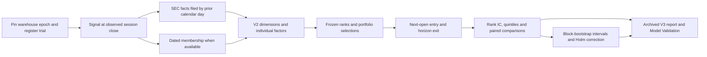
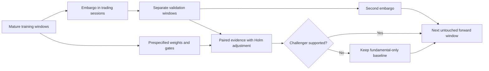

# V3 quantitative signal research

V3 evaluates the existing V2 assessments against subsequent market outcomes.
It retains the fixed legacy ranking as a benchmark and compares each V2 dimension
and prespecified mixture. A company can have strong relative fundamentals,
attractive valuation, favorable technical conditions, or acceptable risk while
the predictive evidence remains inconclusive.

## Protocol



- **Universe.** Security IDs are the join key. Dated membership is restricted to
  the configured seed. The last snapshot at or before the signal is reported
  with its age. A date before the first snapshot is explicitly a
  surviving-universe study. Dated sector classifications and delisting
  settlement returns are unavailable. A missing price path leaves the holding
  unresolved. Known catalogue delistings and unresolved IDs are logged, with
  no assumed liquidation value.
- **As of.** The observed signal close and prior-calendar-day SEC filings define
  the information set. The filing lag is conservative because verified
  publication timestamps are incomplete. Stock and SPY prices come from a
  pinned local publication. Vendor corrections can revise earlier data.
- **Horizons and costs.** 21, 63, 126 and 252 trading sessions. The study starts
  positions at the next adjusted open and sells at the final adjusted close.
  A horizon never reuses the same forward session within its own series.
  Each window is an independently opened and closed equal-dollar book. The
  default fee is 10 basis points per side. A complete window has 200% two-sided
  turnover under that convention. Gaps or unmatched selected prices suppress
  the affected daily portfolio performance.
- **Factors.** Each factor uses the signal-time set with a valid observation.
  Lower P/E and EV/EBITDA, lower volatility and debt/assets, higher FCF yield,
  ROIC, revenue and EPS growth, price/SMA200, momentum and less negative
  drawdown are oriented as favorable. Reported debt/assets is tested separately
  from verified total debt/assets. EPS growth requires both diluted EPS
  observations to originate in one filing and the earlier value to be positive.
  Factor sample sizes differ. Bucket spreads omit short financing.
- **Statistics.** Spearman rank IC requires at least 10 matched securities.
  Mean, median, dispersion and fraction positive describe stability. The
  study reports net quintile returns and the fraction of nondecreasing adjacent
  bucket steps. The SPY regime uses the trailing 126 observed sessions inside
  the study. Earlier dates have an unclassified regime. Within-window feature
  rank correlations are retained. Sector outputs are explicitly unavailable.
- **Uncertainty.** The mean IC and paired return differences use a circular
  block bootstrap over chronological windows, preserving missing positions.
  The block length is the ceiling of the square root of the scheduled window
  count. The report suppresses intervals for fewer than 12 observations,
  coverage below 75%, or constant samples. Effective sample size uses positive
  serial correlation up to the first nonpositive lag. The nominal 95% intervals
  are exploratory. Holm adjusts factor and paired-model p-values separately
  across the four horizons. Dependence between experiments and the restricted
  universe remain important limitations.



The fixed set includes single dimensions, pairwise mixtures, V2 60/25/15,
equal dimension weights, fundamental-heavy and technical-heavy weights, the
legacy rank, and a common-cohort equal-weight portfolio and SPY. Separate
experiments remove the bottom resilience quintile or require the price to
stand above SMA200 before fundamental selection. Ranking comparisons use the
intersection of securities scoreable by both V2 and legacy. The gates may
change coverage and concentration.

Model selection is separate at each horizon. The default expanding training
and last 12 mature validation windows are separated by a one-session
embargo. `--rolling` limits the training history to the requested count.
Every candidate must show a positive paired mean versus fundamental-only in
training and a positive validation interval with Holm-adjusted p below 0.05.
The selector then uses the largest qualifying validation mean. Otherwise it
keeps fundamental-only. With too few mature windows, the adaptive strategy
has no observation. Every candidate and decision is archived and registered
in the local ledger.

## Reproduce the archived run

From the repository root, with the same local publication available:

```sh
env PYTHONPATH=src .venv/bin/python -m finlab.analytics.cli validate-signals \
  2020-01-02 2022-12-30 \
  --epoch 20261122T143857959526Z-848451fc2e9a4d5caa6106a81a244a44
```

The report is `data/reports/research/validation-v3-2020-01-02-2022-12-30-fc70c7a326dc0267.json`.
It records source hash `74fbab985a1d1e975b4f506e447abd827ca84687b2fe9bfb889907055b91231a`,
runtime versions, sizes, weights, windows and input IDs. The code archive is under
`data/reports/research/code/`. `validation-v3-latest.json` is the local pointer used
by the Analytics API. The run is retrospective and does not incorporate
market impact, taxes, financing, or point-in-time sector effects.

## Results

| Forward sessions | Windows | Opportunity mean IC | Fundamental mean IC | Legacy mean IC |
| ---: | ---: | ---: | ---: | ---: |
| 21 | 35 | +0.024 | +0.031 | −0.015 |
| 63 | 11 | −0.013 | +0.021 | −0.061 |
| 126 | 5 | +0.051 | +0.050 | −0.043 |
| 252 | 2 | +0.223 | +0.060 | −0.054 |

The 21-session Opportunity IC interval is **[−0.035, +0.086]** with an estimated
effective sample of 35 windows. The fundamental-only interval is
**[−0.019, +0.072]** with an estimated effective sample of 32.3.
The longer horizons have too few observations for intervals under this
protocol. The adaptive selector kept fundamentals in all nine eligible
21-session windows and had no mature selection at the other horizons.

| 21-session rebalance | Net daily-path Sharpe |
| --- | ---: |
| Opportunity | 0.627 |
| Fundamental-only | 0.712 |
| Legacy five-factor | 0.624 |
| Equal-weight common cohort | 0.548 |
| SPY, matched cost convention | 0.370 |
| Fundamental with risk gate | 0.716 |

The entry filter had insufficient continuous coverage for a compounded
21-session portfolio. The slight risk-gate difference provides descriptive
evidence only. Factor IC intervals at 21 sessions included zero where they
could be estimated. EV/EBITDA, ROIC and reported debt/assets did not have
enough cross-sectional coverage. For example, the study found 30 EV/EBITDA
and 32 ROIC security-window observations out of 3,500 eligible observations.
No model's predictive superiority is established.

## Full 21-session ablations

| Model | Mean rank IC | 95% interval | Net Sharpe | Max drawdown |
| --- | ---: | --- | ---: | ---: |
| Opportunity | 0.024 | [-0.035, 0.086] | 0.627 | -28.5% |
| Fundamental | 0.031 | [-0.019, 0.072] | 0.712 | -29.7% |
| Technical | 0.003 | [-0.057, 0.065] | 0.366 | -31.6% |
| Risk resilience | 0.052 | [-0.035, 0.132] | 0.519 | -31.3% |
| Fundamental + technical | 0.008 | [-0.046, 0.065] | 0.429 | -30.9% |
| Fundamental + risk | 0.053 | [-0.018, 0.122] | 0.720 | -27.8% |
| Technical + risk | 0.022 | [-0.063, 0.101] | 0.470 | -31.1% |
| Equal dimension weights | 0.030 | [-0.045, 0.106] | 0.516 | -31.4% |
| Fundamental heavy | 0.034 | [-0.015, 0.080] | 0.658 | -26.0% |
| Technical heavy | 0.013 | [-0.054, 0.082] | 0.495 | -29.5% |
| Risk constraint | 0.008 | [-0.055, 0.070] | 0.716 | -28.3% |
| Entry timing gate | 0.021 | [-0.045, 0.085] | — | — |
| Legacy | -0.015 | [-0.071, 0.041] | 0.624 | -30.4% |
| Equal-weight cohort | — | — | 0.548 | -30.8% |
| SPY | — | — | 0.370 | -32.1% |
| Adaptive walk-forward | 0.041 | — | 0.598 | -19.7% |

The adaptive portfolio statistics cover only its nine eligible forward windows. Compare them on that matched period.
The archived file includes per-window turnover, adjusted returns, net benchmarks, attribution, factor distributions, and Holm-adjusted paired differences.
