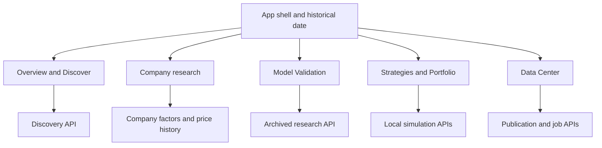

# FinLab Analytics frontend

React, TypeScript, Vite and Lightweight Charts serve the local research workspace. Research, personal
tools, and Data Engine operations share a shell and have distinct navigation groups.
The visual system uses charcoal surfaces, restrained gold emphasis, and labeled
semantic colors for evidence and concerns.

## Run locally

From the repository root, with Python dependencies available and local financial
data already published, run Analytics and Vite in separate terminals.

```sh
env PYTHONPATH=src .venv/bin/python -m finlab.analytics.cli serve --host 127.0.0.1 --port 8000
npm --prefix frontend ci
npm --prefix frontend run dev -- --host 127.0.0.1 --port 5173
```

Open `http://127.0.0.1:5173`. Configure the Vite proxy with
`FINLAB_VITE_API_URL` when Analytics uses a different port. Run the Data Engine
separately for new observations or queued refreshes. A published warehouse
supports offline Analytics.

## Source and view navigation

| File | Responsibility |
| --- | --- |
| `src/main.tsx`, `index.html` | React mount and document metadata. |
| `src/index.css`, `src/App.css` | Theme tokens, accessibility defaults, shell, tables, responsive breakpoints, and chart layout. |
| `src/App.tsx` | Hash navigation, browser history, global company search, historical cutoff, watchlist persistence, request states, company hero and Data Center publication summary. |
| `src/MarketViews.tsx` | Overview snapshot and opportunity cards, compact multidimensional screener, filters, custom columns, sorting and paging. |
| `src/CompanyAssessment.tsx` | Expandable score evidence, grouped indicators, Simple/Quant modes, and filing detail. |
| `src/FinancialChart.tsx` | Lazy financial chart with session ranges, crosshair, moving averages, volume, benchmark and keyboard session inspection. |
| `src/ModelValidation.tsx` | Archived V2/V3 evidence, horizons, model and factor results, uncertainty, quintiles and limitations. |
| `src/ResearchTools.tsx` | Strategy and benchmark views, portfolio CSV and scenario workflow, ingestion status and queued refresh. |
| `src/format.ts` | Shared financial values, labels and research classification formatting. |
| `vite.config.ts`, `scripts/browser-check.mjs` | Local proxy and headless browser interaction checks. |



## Verify

```sh
npm --prefix frontend run build
npm --prefix frontend run lint
```

The earlier browser script records the V3 baseline. Run the V4 Playwright
journeys against a published warehouse and running local app:

```sh
FINLAB_E2E_URL=http://127.0.0.1:5173 npm --prefix frontend run test:e2e
```

Playwright uses the installed Chrome channel and stores evidence under
`data/reports/ui-v4/`. An alternate binary can be passed as
`FINLAB_CHROME_PATH`. See [V4 product documentation](../docs/product_v4.md)
and [V4 UX audit](../docs/ux_v4_audit.md). The Playwright suite expects the
historical AAPL fixture available in the local publication and the archived V3 report.
